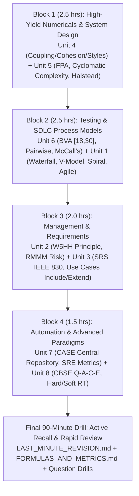

# 🎓 Software Engineering (303105253) — Complete Exam Study Guide & Repository

[](https://opensource.org/licenses/MIT)
[](https://docs.github.com/en/get-started/writing-on-github)
[-green.svg)](#)
[](https://www.paruluniversity.ac.in)
[](#)

> [!IMPORTANT]
> **⚡ EMERGENCY EXAM PREPARATION NOTICE:**  
> This repository is a **comprehensive, beginner-friendly, and high-yield study system** designed specifically for the **Software Engineering (303105253)** final examination.  
> It covers **100% of all 8 course modules (321 lecture slides)**, textbook theory from **Roger S. Pressman** & **Ian Sommerville**, and the **Parul University Examination Blueprint** (Section A & B: 2-mark definitions, 4-mark comparisons, and 5-mark design & numerical problems).

---

## 🧭 Repository Quick Navigation

```
se-exam-study-guide/
├── 📄 README.md                     <-- (You are here) Master Dashboard & 24-Hour Study Plan
├── 🗺️ SYLLABUS.md                   <-- Slide-by-slide 321-slide master topic inventory & taxonomy
├── ⚡ LAST_MINUTE_REVISION.md       <-- High-yield 30-min cram guide with key distinctions & formulas
├── 📐 FORMULAS_AND_METRICS.md       <-- Complete cheat sheet: Cyclomatic Complexity, FPA, Halstead, SRE
├── 📖 GLOSSARY.md                   <-- A-to-Z software engineering definitions & keywords
├── 📂 docs/
│   ├── 📂 units/                    <-- Unit 1 to Unit 8 in-depth study notes with code & diagrams
│   ├── 📂 practice/                 <-- MCQs, 2-mark Short Answers, 4/5-mark Long Answers & Numericals
│   └── 📂 question-bank/            <-- Master predicted question bank with Parul University blueprints
└── 📂 sources/
    └── 📚 references.md             <-- Citations, textbooks, academic papers & IEEE standards
```

---

## 📚 Unit Study Modules (Core Syllabus)

| Unit | Module Title | Source Slides | Exam Priority | Est. Time | Direct Markdown Link |
| :---: | :--- | :---: | :---: | :---: | :--- |
| **01** | **Introduction & Process Models** | 89 Slides | 🔥 **High** | 75 mins | [📖 Read Unit 1](docs/units/unit-01-introduction-and-process-models.md) |
| **02** | **Software Project Management** | 23 Slides | 🔥 **High** | 45 mins | [📖 Read Unit 2](docs/units/unit-02-software-project-management.md) |
| **03** | **Requirements Engineering** | 32 Slides | 🔥 **High** | 50 mins | [📖 Read Unit 3](docs/units/unit-03-requirements-engineering.md) |
| **04** | **Structured System Design** | 67 Slides | 🚨 **Critical** | 80 mins | [📖 Read Unit 4](docs/units/unit-04-structured-system-design.md) |
| **05** | **Coding, Metrics & Unit Testing** | 34 Slides | 🚨 **Critical** | 75 mins | [📖 Read Unit 5](docs/units/unit-05-coding-and-unit-testing.md) |
| **06** | **Testing & Quality Assurance** | 53 Slides | 🚨 **Critical** | 75 mins | [📖 Read Unit 6](docs/units/unit-06-software-testing-and-quality-assurance.md) |
| **07** | **CASE Tools & Dependability** | 11 Slides | ⚡ **Medium** | 35 mins | [📖 Read Unit 7](docs/units/unit-07-case-tools-and-system-dependability.md) |
| **08** | **Advanced Software Engineering** | 12 Slides | ⚡ **Medium** | 35 mins | [📖 Read Unit 8](docs/units/unit-08-advanced-software-engineering.md) |

---

## 🎯 Exam Practice & Question Bank

| Practice Section | Content & Focus | Exam Format Weightage | Link |
| :--- | :--- | :--- | :---: |
| **50+ Conceptual MCQs** | Interactive quizzes with distractor traps & explanations | Conceptual Foundation | [🧪 Take Quiz](docs/practice/mcqs-and-quizzes.md) |
| **Short Answers (2 Marks)** | Mandatory definitions, distinctions, and formulas | Section A/B Q.1 Compulsory | [📝 Study 2-Markers](docs/practice/short-answers-2-marks.md) |
| **Long Answers (4 & 5 Marks)** | Analytical, comparative & architectural models | Section A/B Q.2 & Q.3 Options | [📝 Study Long Answers](docs/practice/long-answers-4-and-5-marks.md) |
| **Step-by-Step Numericals** | Solved problems: FPA, Halstead, CC, Availability, BVA | Section A/B Q.3 Numericals | [🧮 Solve Numericals](docs/practice/solved-numericals.md) |
| **Master Question Bank** | Full unit-by-unit predicted question inventory | Parul University Blueprint | [🏆 View Question Bank](docs/question-bank/master-question-bank.md) |

---

## ⏱️ 24-Hour Emergency Study Strategy



---

## 🏆 Top 10 Topics You MUST NOT Skip!

1. 🧮 **Albrecht's Function Point Analysis (FPA):** The 5 functional units ($EI, EO, EQ, ILF, EIF$), 14 GSCs ($\sum f_i = 43$), $UFP = 378, VAF = 1.08, FP = 408$, productivity, documentation, and cost calculations. ([Go to Unit 5](docs/units/unit-05-coding-and-unit-testing.md#function-point-analysis))
2. 🧮 **McCabe's Cyclomatic Complexity:** Formulas $V(G) = E - N + 2P$ and $V(G) = P_{\text{pred}} + 1$. ([Go to Unit 5](docs/units/unit-05-coding-and-unit-testing.md#cyclomatic-complexity))
3. 📐 **Coupling vs. Cohesion:** All 7 levels of Cohesion (Functional down to Coincidental) and all 7 levels of Coupling (Data up to Content). ([Go to Unit 4](docs/units/unit-04-structured-system-design.md#coupling-and-cohesion))
4. 🔄 **Barry Boehm's Spiral Model:** The 4 quadrants (Planning, Risk Analysis, Engineering, Evaluation) and why it is "risk-driven." ([Go to Unit 1](docs/units/unit-01-introduction-and-process-models.md#spiral-model))
5. 🧪 **Boundary Value Analysis (BVA):** The 7-point test suite for age range $[18, 30]$ ($17, 18, 19, 24, 29, 30, 31$). ([Go to Unit 6](docs/units/unit-06-software-testing-and-quality-assurance.md#boundary-value-analysis))
6. 📊 **McCall's 11 Quality Factors:** Product Operation, Product Revision, and Product Transition ($O-R-T$). ([Go to Unit 6](docs/units/unit-06-software-testing-and-quality-assurance.md#mccalls-quality-factors))
7. 💼 **Barry Boehm's W5HH Principle:** The 7 fundamental management questions (Why, What, When, Who, Where, How, How Much). ([Go to Unit 2](docs/units/unit-02-software-project-management.md#w5hh-principle))
8. 📋 **Use Case Relationships:** Semantic and arrow difference between `<<include>>` (mandatory) and `<<extend>>` (optional). ([Go to Unit 3](docs/units/unit-03-requirements-engineering.md#use-case-modeling))
9. 🧩 **CBSE Framework Activities:** Qualification, Adaptation, Composition, and Evolution ($Q-A-C-E$). ([Go to Unit 8](docs/units/unit-08-advanced-software-engineering.md#component-based-software-engineering))
10. 📈 **System Reliability & Availability:** Formulas for $MTBF = MTTF + MTTR$ and $A = \frac{MTTF}{MTBF}$. ([Go to Unit 7](docs/units/unit-07-case-tools-and-system-dependability.md#reliability-engineering))

---

## 📋 Comprehensive Topic Revision Checklist

Use this Markdown checklist to track your exam readiness:

### Unit 1: Introduction & Process Models
- [ ] Definition of Software Engineering (IEEE) and 3-part definition of Software
- [ ] Hardware Bathtub Curve vs. Software Failure/Deterioration Curve
- [ ] The Software Crisis: Causes, symptoms, and software myths
- [ ] Layered Technology: Quality Focus, Process, Methods, Tools
- [ ] Generic View of SE: Definition ("What"), Development ("How"), Support ("Change": 4 maintenance types)
- [ ] Waterfall Model & V-Model (Verification vs. Validation)
- [ ] Incremental, Iterative, and RAD (Rapid Application Development) Models
- [ ] Prototyping Model & Barry Boehm's Spiral Model (4 Quadrants)
- [ ] Agile Manifesto Values, Scrum Framework (Roles, Artifacts, Ceremonies), and XP practices
- [ ] UML Structural (Class, Object, Component, Deployment) vs. Behavioral (Use Case, Sequence, Activity, State) diagrams

### Unit 2: Software Project Management
- [ ] The Management Spectrum: 4 P's (People, Product, Process, Project)
- [ ] Barry Boehm's W5HH Principle (7 Questions)
- [ ] Team Structures: Democratic Decentralized, Controlled Centralized, Controlled Decentralized
- [ ] Software Risk Management: Risk Identification, Projection, Assessment, and the RMMM Plan
- [ ] Key Performance Indicators (KPIs): Schedule Variance, Effort Variance, Velocity
- [ ] Management Tracking Tools: JIRA, Trello, MS Project

### Unit 3: Requirements Engineering
- [ ] 5-Step Requirements Engineering Process: Feasibility, Elicitation, Specification, Validation, Management
- [ ] Feasibility Study Dimensions: Technical, Operational, Economic ($T-O-E$)
- [ ] Requirements Elicitation Techniques: Interviews, FAST, Brainstorming, Prototyping
- [ ] Functional vs. Non-Functional Requirements (FURPS+ Model)
- [ ] Software Requirements Specification (SRS) & IEEE 830 Standard (7 Quality Attributes)
- [ ] Use Case Modeling: Actors, System Boundary, `<<include>>`, `<<extend>>`, Generalization
- [ ] Requirements Analysis & Modeling: Context Diagram (Level 0 DFD), DFD Level 1/2, Data Dictionary, ERD
- [ ] Requirements Validation: Formal Reviews, Walkthroughs, Inspections

### Unit 4: Structured System Design
- [ ] Fundamental Design Concepts: Abstraction, Modularity, Refinement, Information Hiding, Refactoring
- [ ] Software Architecture Styles: Data-Centered, Data-Flow (Pipe & Filter), Call-and-Return, Layered (N-Tier), Object-Oriented
- [ ] Architecture Tradeoff Analysis Method (ATAM): 9-Step Evaluation & Utility Tree
- [ ] Peter Chen's ER Model (1976): Entities, Weak Entities, Attributes (Simple, Composite, Derived, Multi-valued)
- [ ] Dataflow Modeling: Logical DFD vs. Physical DFD
- [ ] Control Flow Model (CFD), Process Specifications (P-Spec, C-Spec), and Bug Lifecycle
- [ ] **Coupling (7 Levels):** No Direct, Data, Stamp, Control, External, Common, Content
- [ ] **Cohesion (7 Levels):** Functional, Sequential, Communicational, Procedural, Temporal, Logical, Coincidental

### Unit 5: Coding and Unit Testing
- [ ] Coding Guidelines & Standards: Line length $\le 80$ chars, naming conventions, comments
- [ ] Software Principles: KISS, DRY, YAGNI
- [ ] SOLID Principles: Single Responsibility, Open/Closed, Liskov Substitution, Interface Segregation, Dependency Inversion
- [ ] Unit Testing: Procedural Units vs. Object-Oriented Classes
- [ ] Fagan Code Inspection (6 Formal Phases) vs. Informal Walkthroughs
- [ ] McCabe's Cyclomatic Complexity: $V(G) = E - N + 2P = P_{\text{pred}} + 1$
- [ ] Function Point Analysis (FPA): 5 Information Parameters, $UFP$, 14 GSC factors, $VAF$, $FP$
- [ ] Halstead Software Science Metrics: $n_1, n_2, N_1, N_2$, Program Vocabulary, Length, Volume, Difficulty, Effort, Time
- [ ] Knot Count Metric for unstructured spaghetti code

### Unit 6: Software Testing & Quality Assurance
- [ ] Concept of Quality: "Fit for purpose", Verification vs. Validation (Boehm's Law)
- [ ] Psychology of Testing: Finding errors, developer bias
- [ ] Levels of Testing: Unit, Integration (Top-Down Stubs, Bottom-Up Drivers, Regression, Smoke), System, Acceptance (Alpha & Beta)
- [ ] IEEE 829 Test Plan Standard: 8-Step Process
- [ ] Black-Box Testing: Boundary Value Analysis (BVA), Equivalence Partitioning (EP), Pairwise Testing, State-Based Testing
- [ ] White-Box Testing: Basis Path Testing, Statement/Branch Coverage
- [ ] SQA Concepts: Quality Assurance (QA) vs. Quality Control (QC), Cost of Quality
- [ ] McCall's 11 Quality Factors: Product Operation, Revision, and Transition
- [ ] ISO 9000 & 9001 Standards: 7-Step Certification Process & Document Control
- [ ] SEI Capability Maturity Model Integration (CMMI Levels 1 to 5)

### Unit 7: CASE Tools & Dependability
- [ ] CASE Tools Architecture & Central Repository Functions
- [ ] Upper CASE vs. Lower CASE vs. Integrated CASE (I-CASE)
- [ ] Integrating CASE Tools with Scrum / Agile Sprints
- [ ] System Dependability: Reliability, Availability, Safety, Security, Resilience
- [ ] Software Reliability Engineering (SRE) Metrics: $MTTF, MTTR, MTBF, \text{Availability}, \lambda$
- [ ] Safety Engineering & Hazard Analysis (Safety-Critical Systems)
- [ ] Security Engineering: CIA Triad & Threat Modeling

### Unit 8: Advanced Software Engineering
- [ ] Software Reuse: Benefits, inhibitors (NIH Syndrome), and 4 levels of reuse
- [ ] Component-Based Software Engineering (CBSE): Component definitions, Provides vs. Requires interfaces
- [ ] CBSE Framework Activities: Qualification, Adaptation, Composition, Evolution ($Q-A-C-E$)
- [ ] Distributed Software Engineering: Client-Server (2-tier, 3-tier, N-tier) and Peer-to-Peer (P2P)
- [ ] Service-Oriented Software Engineering (SOSE): SOA, Web Services, RESTful APIs vs. SOAP, Microservices
- [ ] Real-Time Software Engineering: Hard vs. Soft Real-Time systems, stimulus-response patterns, scheduling
- [ ] Systems Engineering: Socio-technical systems & System of Systems (SoS)

---

## 💻 Git & GitHub Usage Instructions

### Clone this Repository Locally
```bash
git clone https://github.com/your-username/se-exam-study-guide.git
cd se-exam-study-guide
```

### Viewing on GitHub
All Markdown files are formatted to render natively on GitHub with syntax highlighting, mathematical equations ($KaTeX$), and responsive diagrams ($Mermaid$).
