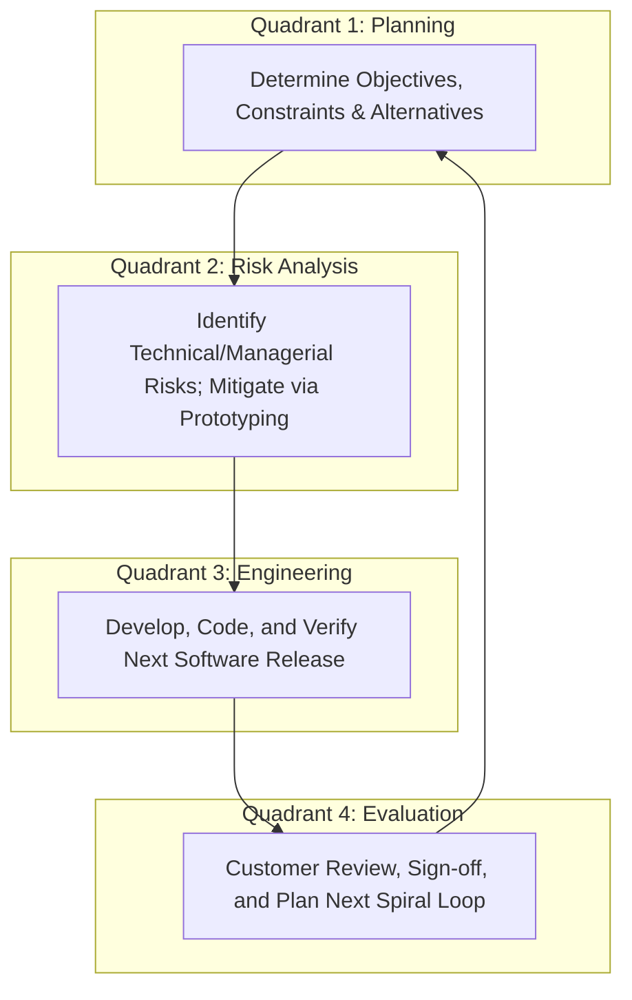
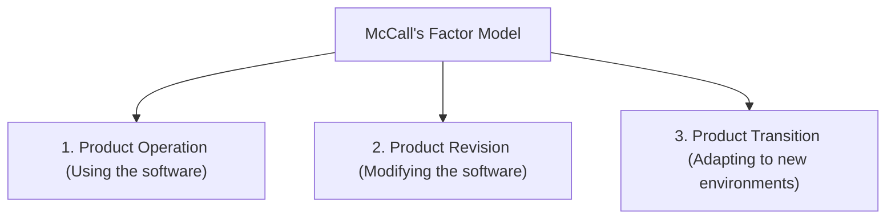

# 📚 Section A & B Q.2 & Q.3 Model Long Answers (4 & 5 Marks)

---

### Q1-1: Explain the difference between hardware wear-out and software deterioration. Draw and explain the curves. [4 Marks]

**Model Answer:**
Physical hardware and digital software exhibit fundamentally different failure behaviors over their operational lifetimes:

#### 1. Hardware Wear-Out (The Bathtub Curve)

Hardware exhibits the classic **Bathtub Curve** with three distinct operational phases:

1. _Infant Mortality (Burn-in phase):_ High failure rate early in life due to manufacturing flaws and component assembly defects.
2. _Steady-State Operational Life:_ Failure rate drops to a low, constant plateau where failures occur randomly.
3. _Wear-Out Phase:_ Failure rate rises steeply toward the end of life due to physical friction, heat stress, oxidation, and mechanical degradation.

#### 2. Software Deterioration Curve

Software does **not** wear out because it has no physical moving parts, friction, or environmental vulnerability.

1. _Early Phase:_ High failure rate initially as residual coding and design bugs are discovered and fixed.
2. _Idealized Curve:_ Theoretically, the failure rate should plateau at a permanent, near-zero level.
3. _Actual Deterioration Curve:_ In reality, as the software is operated, users request modifications (adaptive and perfective maintenance). Each patch introduces **unintended side effects** into the codebase. Consequently, the failure rate spikes after every maintenance release, causing the software to **deteriorate** over time until architectural integrity collapses.

```
Hardware Bathtub Curve:             Actual Software Failure Curve:
Failure Rate                         Failure Rate
   |  \                           /    |  \        /\      /\     /\
   |   \                         /     |   \  ___/  \___/  \___/  \_
   |    \_______                 /      |    \/ (Spikes due to patches)
   |            \_______________/       |
   +------------------------------>      +------------------------------>
              Time                                     Time
```

---

### Q1-2: Explain Barry Boehm's Spiral Model with a neat diagram. Why is it called a Risk-Driven model? [5 Marks]

**Model Answer:**

#### 1. Concept & Significance

Proposed by Dr. Barry Boehm (1988), the **Spiral Model** is an evolutionary process model that couples the iterative nature of prototyping with the controlled, systematic aspects of the Waterfall model. It is explicitly called a **risk-driven model** because every cycle begins with an assessment of technical and managerial risks and uses prototyping to resolve them before committing to expensive full-scale development.

#### 2. The 4 Quadrants of the Spiral

The model is visualized as an expanding spiral traversing four quadrants:

1. **Quadrant 1: Planning (Determine Objectives & Constraints):**
   - Identify project goals, alternative architectural solutions, and operational constraints (budget, timeline, hardware limits).
2. **Quadrant 2: Risk Analysis (Identify and Resolve Risks):**
   - Dedicated risk evaluation step. Potential technical risks (e.g., untried algorithms, GUI usability, network latency) are identified and mitigated using prototypes, mathematical simulations, and benchmarking.
3. **Quadrant 3: Engineering & Construction (Develop & Verify):**
   - The software increment is designed, coded, and verified using standard SDLC methods. If risk is low, Waterfall or RAD can be applied within this quadrant.
4. **Quadrant 4: Evaluation (Review & Plan Next Phase):**
   - Customer evaluates the delivered increment. Based on feedback, management decides whether to proceed to the next spiral loop or terminate the project.



#### 3. Advantages & Applications

- _Advantages:_ Superb risk handling; realistic iterative development; changes accommodated smoothly.
- _Applications:_ Large, high-budget, complex, safety-critical systems (e.g., aerospace systems, operating systems like Windows).

---

### Q4-1: Explain all 7 levels of Module Cohesion from highest to lowest with examples. [5 Marks]

**Model Answer:**
**Cohesion** measures the degree to which elements within a single software module belong together functionally. Designers must strive for the **Highest Cohesion**.

```
HIGHEST (BEST)   -------------------------------------------->   LOWEST (WORST)
Functional > Sequential > Communicational > Procedural > Temporal > Logical > Coincidental
```

1. **Functional Cohesion (Highest / Best):**
   - Every instruction inside the module performs exactly one, and only one, well-defined mathematical or logical function.
   - _Example:_ `compute_sine(angle)` or `calculate_square_root(n)`.
2. **Sequential Cohesion:**
   - Elements are grouped because the output data produced by one element serves as the direct input data to the next element.
   - _Example:_ `read_sensor_data_and_format_to_json()`.
3. **Communicational Cohesion:**
   - Elements perform different functions, but all operate on the exact same input data or modify the same output data.
   - _Example:_ `update_and_print_customer_profile(customer_record)`.
4. **Procedural Cohesion:**
   - Elements are grouped together because they execute in a specific sequential order, although they operate on different data.
   - _Example:_ `verify_file_permissions_then_read_network_packet()`.
5. **Temporal Cohesion:**
   - Elements are grouped purely because they must execute within the same timeframe during execution.
   - _Example:_ `system_boot_initialization()` (loading configs, resetting hardware clocks, opening log files).
6. **Logical Cohesion:**
   - Elements perform conceptually similar activities (e.g., I/O operations), but a control parameter determines which one actually runs.
   - _Example:_ `handle_device_input(int device_type)`.
7. **Coincidental Cohesion (Lowest / Worst):**
   - Elements have no meaningful functional, data, or procedural relationship whatsoever; grouped purely by accident.
   - _Example:_ `UtilitiesHelper` class containing `convert_string()`, `play_sound()`, and `calculate_tax()`.

---

### Q4-2: Explain all 7 levels of Module Coupling from best to worst. Why is Common Coupling dangerous? [5 Marks]

**Model Answer:**
**Coupling** measures the degree of interdependence and communication between distinct software modules. Designers must strive for the **Lowest Coupling**.

```
LOWEST (BEST)    -------------------------------------------->   HIGHEST (WORST)
No Direct > Data > Stamp > Control > External > Common > Content
```

1. **No Direct Coupling (Best):** Modules are completely independent and communicate neither directly nor indirectly.
2. **Data Coupling:** Modules communicate strictly by passing primitive scalar parameters (`int`, `float`, `boolean`).
3. **Stamp Coupling:** Modules share a composite data structure (e.g., an object or C struct), but only need a few fields from it.
4. **Control Coupling:** One module passes a control flag or token that dictates the internal control flow and decision logic of the other module.
5. **External Coupling:** Modules are tied to external communication protocols, specific hardware devices, or operating system interfaces.
6. **Common Coupling:** Multiple modules read and write to the same **Global Data Area** or shared memory.
7. **Content Coupling (Worst / Pathological):** One module directly modifies or accesses the internal code, private data structures, or execution branches of another module.

#### Why Common Coupling is Dangerous:

Common coupling introduces severe architectural fragility:

- If Module A writes corrupted data to the global area, Modules B, C, and D will fail unpredictably. Tracking down which module caused the corruption is extremely difficult.
- It destroys module reusability because no module can be extracted without bringing the entire global memory state with it.

---

### Q6-1: Explain McCall's Software Quality Model. Describe the 11 quality factors categorized into Product Operation, Revision, and Transition. [5 Marks]

**Model Answer:**
Developed by Jim McCall (1977), this model bridges the gap between user perspectives and technical software metrics by organizing **11 quality factors** into **3 operational perspectives (O-R-T)**:



#### 1. Product Operation Factors (5 Factors)

Evaluates how well the software performs in daily operational use:

1. **Correctness:** The extent to which software meets its specification and fulfills customer functional objectives.
2. **Reliability:** The extent to which the software performs failure-free operation over a specified time in a given environment.
3. **Efficiency:** The amount of hardware and computational resources (CPU, RAM, disk) consumed by the software.
4. **Integrity:** The ability to control and prevent unauthorized access to software data (Security).
5. **Usability:** The mental and physical effort required to learn, operate, and interpret output from the software.

#### 2. Product Revision Factors (3 Factors)

Evaluates the effort required to modify, maintain, and test the software: 6. **Maintainability:** The effort required to locate and correct a bug in an operational program. 7. **Flexibility:** The effort required to modify operational software to accommodate new customer feature requests. 8. **Testability:** The effort required to test software to ensure it performs its intended functions without errors.

#### 3. Product Transition Factors (3 Factors)

Evaluates the effort required to transfer the software into new execution environments: 9. **Portability:** The effort required to migrate software from one hardware/OS platform to another. 10. **Reusability:** The extent to which components can be reused in other applications without re-engineering. 11. **Interoperability:** The effort required to couple and exchange data between this software and other external systems.

---

### Q8-1: What is Component-Based Software Engineering (CBSE)? Explain its 4 framework activities. [5 Marks]

**Model Answer:**
**Component-Based Software Engineering (CBSE)** is a software development paradigm that emphasizes assembling software applications from pre-existing, independent, loosely coupled, and reusable software components.

#### Component Interface Contracts

A component interacts with the world via two formal interfaces:

- **Provides Interface (Lollipop `---O`):** Services offered by the component.
- **Requires Interface (Socket `---(`):** Services required by the component to run.

#### The 4 CBSE Framework Activities (Q-A-C-E)

1. **Component Qualification:**
   - Candidate Commercial Off-The-Shelf (COTS) components are evaluated to verify whether they satisfy system functional and non-functional requirements (performance, reliability, security, licensing, documentation).
2. **Component Adaptation:**
   - Because qualified components were built independently, interface mismatches occur. Engineers write **Adapters or Wrappers** to translate data formats and parameter signatures between the component and the target architecture.
3. **Component Composition:**
   - Adapted components are assembled into the master software architecture using glue code, middleware, and message buses.
4. **Component Update / Evolution:**
   - Managing component lifecycle, version upgrades, security patches, and replacing obsolete components over time without breaking the rest of the application.
