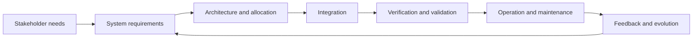
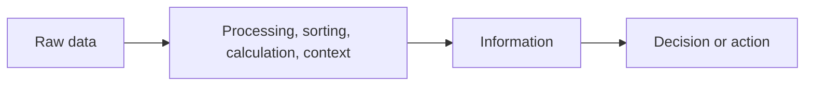
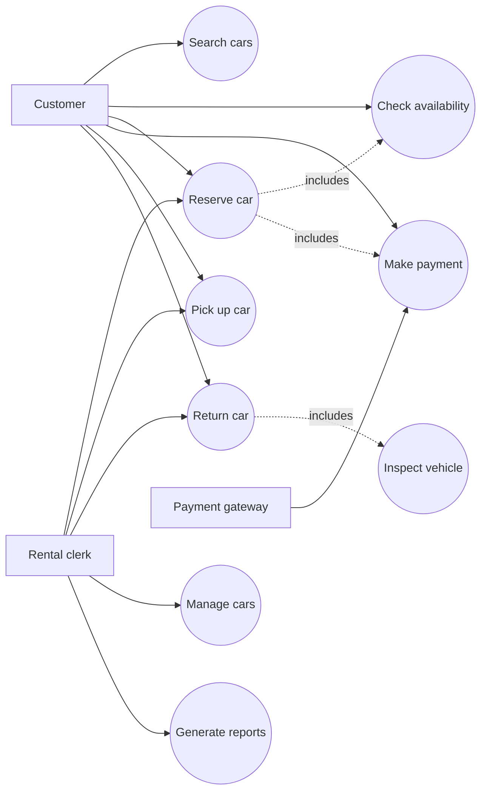
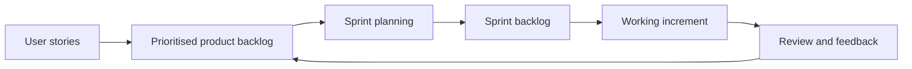
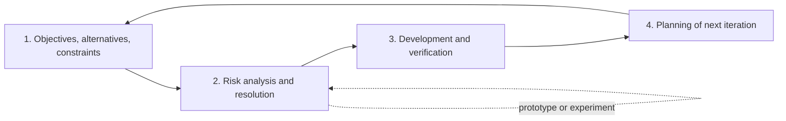

# 🎓 Previous-Year Final Paper: Complete Questions & Answers

> **Source:** Parul University Winter 2025–26 Examination, 21 November 2025  
> **Subject:** Software Engineering / Fundamentals of Software Engineering  
> **Subject Codes:** `303105253 / 203105303 / 203124253`  
> **Maximum Marks:** 60 &nbsp;|&nbsp; **Time:** 2:00 pm–4:30 pm  
> **Purpose:** Detailed answer-writing guide for revision and mock-exam practice.

---

## 🧭 How to Use This Guide

This document covers **every question printed in the paper**, including every **OR** alternative. In the actual examination, answer only the required option; while revising, study both choices because the alternative often tests the same unit from a different angle.

### 📊 Paper Pattern and Marking System

| Section | Question | Pattern | Marks | Attempt |
| :--- | :--- | :--- | :---: | :--- |
| A | Q.1 | A and B, each with three sub-parts | 6 + 6 | **Compulsory** |
| A | Q.2 | A: 4 marks; B: 5 marks | 9 | One B option |
| A | Q.3 | A: 4 marks; B: 5 marks | 9 | One B option |
| B | Q.1 | A and B, each with three sub-parts | 6 + 6 | **Compulsory** |
| B | Q.2 | A: 4 marks; B: 5 marks | 9 | One B option |
| B | Q.3 | A: 4 marks; B: 5 marks | 9 | One B option |

> **Important:** The printed totals add to 60 marks. Section A and Section B must be written in separate answer books.

### ✍️ General Mark-Scoring Strategy

- **4 marks:** Definition or introduction (1) + four technically correct points (2) + importance/example/conclusion (1).
- **5 marks:** Definition (1) + four or five explained points (3) + example, diagram, comparison, or conclusion (1).
- **6 marks:** Divide the answer visibly among the three sub-parts. Usually give about **2 marks per sub-part**: definition/explanation plus key points or example.
- Underline keywords such as **risk-driven**, **iterative**, **feedback**, **static analysis**, **product backlog**, and **risk assessment**.
- Draw a clean labelled diagram wherever one is suggested. A diagram should support the explanation, not replace it.
- If an assumption is needed, write it explicitly before solving: *“Assume the car-rental system has Customer, Clerk, and Payment Gateway actors.”*

---

# 🟦 SECTION A — Process, Management and Quality

## Q.1(A) Answer the Following Questions — 6 Marks

### (a) What are the Key Characteristics of the Waterfall Model? — 2 Marks

The **Waterfall model** is a linear-sequential software process in which development proceeds through well-defined phases. The output of one phase becomes the input to the next phase.

**Key characteristics:**

1. **Sequential phases:** Requirements → Design → Implementation → Testing → Deployment → Maintenance.
2. **Phase completion:** A phase is normally completed and documented before the next phase begins.
3. **Early baseline and documentation:** Requirements, design decisions, test plans, and reviews are documented at milestones.
4. **Limited change tolerance:** Changes after requirements approval are expensive because earlier work may need to be revisited.
5. **Verification at each stage:** Reviews and approvals are used as gates between phases.

**Best suited for:** Stable, well-understood requirements such as regulated or contract-driven projects.

> 🧠 **Remember:** **W-D-I-T-D-M** — *Waterfall Design Is Tested During Maintenance* (use the actual sequence: requirements, design, implementation, testing, deployment, maintenance).

### (b) How Does the Agile Model Improve Flexibility in Software Development? — 2 Marks

Agile improves flexibility by developing software in short, repeated **iterations or sprints** instead of waiting until the end of the project.

- Requirements are maintained in a **prioritised product backlog** and can be reprioritised between iterations.
- The customer or product owner gives frequent feedback on working increments.
- Testing and integration occur continuously, so defects and misunderstandings are found early.
- Cross-functional teams collaborate closely and respond to changing business priorities.

Thus, Agile reduces the cost of change and delivers valuable functionality early.

> 💡 **Exam phrase:** *Agile welcomes changing requirements, even late in development, when the change improves customer value.*

### (c) Compare the Advantages of the Spiral and Incremental Models — 2 Marks

| Point | Spiral Model | Incremental Model |
| :--- | :--- | :--- |
| Main focus | Risk identification and reduction | Early delivery of usable functionality |
| Development | Repeated cycles of planning, risk analysis, engineering, and evaluation | Product is divided into increments delivered one after another |
| Advantage | Suitable for large, complex, high-risk systems; prototypes reduce uncertainty | Customer gets useful software early; feedback guides later increments |
| Limitation | More expensive and difficult to manage; needs risk expertise | Architecture and integration can become difficult if increments are poorly planned |

**Common advantage:** Both are iterative and permit feedback and refinement. The difference is that Spiral is primarily **risk-driven**, while Incremental development is primarily **delivery-driven**.

---

## Q.1(B) Project Monitoring — 6 Marks

### (a) Define a Project Monitoring Plan

A **Project Monitoring Plan** is a documented plan that specifies what project information will be measured, who will collect it, how frequently it will be reviewed, how deviations will be reported, and what corrective action will be taken.

It compares actual project performance with the approved baseline for **scope, schedule, cost, effort, quality, and risk**.

### (b) Activities Carried Out in Project Monitoring

1. Establish measurable baselines and milestones.
2. Collect actual data on effort, expenditure, completed work, defects, and schedule.
3. Compare actual performance with planned performance.
4. Calculate variances and key performance indicators.
5. Review risks, issues, dependencies, and change requests.
6. Report status to stakeholders through dashboards or review meetings.
7. Identify corrective or preventive actions.
8. Track actions to closure and update the project plan when approved.

### (c) Explain Any Two Project-Monitoring Activities

#### 1. Schedule and Effort Variance Analysis

The manager compares planned tasks and person-hours with actual completion and effort. A delay or effort overrun is investigated to find its cause—such as underestimated complexity, staff unavailability, or dependency failure. The schedule or resource allocation is then corrected.

#### 2. Risk and Issue Review

The team reviews the risk register and checks whether probability, impact, owners, or mitigation actions have changed. An uncertain future event is a **risk**; an event that has already occurred is an **issue**. High-priority items are assigned owners and due dates.

#### 3. Quality and Defect Tracking

Defect counts, severity, rework, test pass rate, and review findings are monitored. Increasing high-severity defects may trigger additional reviews, test automation, or a release delay.

#### 4. Milestone and Status Reporting

At each milestone, the manager records completed deliverables, pending work, decisions, risks, and actions. A concise report gives stakeholders an early warning instead of waiting for final delivery.

> 🧠 **Memory aid:** **B-C-C-R-A-T** — **B**aseline, **C**ollect, **C**ompare, **R**eview risks, **A**ct, **T**rack.

---

## Q.2(A) What Is Software Reliability? Explain Its Importance in Quality Assurance — 4 Marks

### Definition

**Software reliability** is the probability that software will perform its specified functions without failure for a specified time in a specified environment and under specified operating conditions.

Reliability is not the same as “the software has no bugs.” It is an operational measure: how consistently the software delivers correct service during use.

### Importance in Quality Assurance

1. **Builds user trust:** Reliable software behaves predictably and reduces service interruptions.
2. **Reduces operational cost:** Fewer failures mean less debugging, downtime, emergency support, and rework.
3. **Protects safety and data:** Reliability is essential in medical, financial, transport, and embedded systems.
4. **Supports measurable quality goals:** QA can track failure rate, mean time to failure, defect density, and availability.
5. **Guides testing and prevention:** Reliability evidence helps QA decide where more testing, reviews, fault tolerance, or monitoring is required.

### Useful Relationship

For a repairable system:

$$
\text{MTBF} = \text{MTTF} + \text{MTTR}
$$

where **MTTF** is mean time to failure and **MTTR** is mean time to repair. Higher MTTF and lower MTTR generally improve availability.

> ✅ **Conclusion:** Reliability is a quality attribute demonstrated during realistic operation, not merely claimed after code compilation.

---

## Q.2(B) How Does the W5HH Principle Help in Software Project Planning? — 5 Marks

The **W5HH principle**, proposed by Barry Boehm, structures project planning around seven questions. It prevents vague planning by connecting objectives, responsibilities, methods, schedule, and resources.

| Question | Planning Meaning |
| :--- | :--- |
| **Why** is the system being developed? | Clarifies business need, objectives, expected value, and success criteria. |
| **What** will be done? | Defines scope, functions, deliverables, constraints, and acceptance criteria. |
| **When** will it be accomplished? | Establishes milestones, release dates, dependencies, and schedule. |
| **Who** is responsible? | Assigns roles, ownership, authority, and accountability. |
| **Where** are they organisationally located? | Clarifies team structure, communication paths, locations, and coordination needs. |
| **How** will the job be done technically and managerially? | Selects process model, architecture, tools, estimation, tracking, and risk controls. |
| **How much** of each resource is needed? | Estimates people, effort, cost, equipment, space, and time. |

### Benefits

- Converts an abstract project idea into an actionable plan.
- Exposes missing scope, ownership, dependencies, and resource assumptions.
- Supports estimation and risk identification.
- Provides a basis for monitoring progress and explaining decisions to stakeholders.

> 🧠 **Remember:** **Why–What–When–Who–Where–How–How much**. The first five define the context; the last two define execution and resources.

---

## Q.2(B) — OR — Explain System Engineering and What It Handles in Detail — 5 Marks

**System engineering** is an interdisciplinary engineering approach for specifying, designing, integrating, verifying, deploying, operating, and retiring a complete system. It considers software as one part of a larger combination of hardware, people, procedures, data, facilities, and external systems.

### What System Engineering Handles

1. **Stakeholder needs and requirements:** Identifies users, operational goals, constraints, regulations, and acceptance criteria.
2. **System boundary and decomposition:** Defines what is inside the system and divides it into subsystems and components.
3. **Hardware–software–human interaction:** Allocates responsibilities to software, hardware, operators, networks, and procedures.
4. **Architecture and interfaces:** Defines data, control, physical, and communication interfaces between subsystems.
5. **Trade-off analysis:** Balances cost, performance, reliability, safety, security, maintainability, and schedule.
6. **Integration and verification:** Builds the complete system and verifies each requirement at component, subsystem, and system levels.
7. **Operation and lifecycle management:** Supports deployment, training, maintenance, upgrades, retirement, and disposal.



> 💡 **Distinguish:** Software engineering focuses mainly on software; system engineering manages the **whole system and its boundaries**.

---

## Q.3(A) Significance of Programming Principles, Coding Standards and Best Practices — 4 Marks

### Programming Principles

Principles such as **KISS** (Keep It Simple), **DRY** (Don't Repeat Yourself), **YAGNI** (You Aren't Gonna Need It), modularity, abstraction, and single responsibility guide developers toward simple and maintainable designs.

### Coding Standards

Coding standards specify naming, indentation, file organisation, comments, error handling, security rules, and forbidden constructs. They create a common language across a team and make code reviews faster.

### Best Practices

Practices such as version control, peer review, automated testing, continuous integration, meaningful commits, secure input validation, and refactoring reduce defects and technical debt.

### Overall Significance

- Improves readability and maintainability.
- Reduces defects and inconsistency.
- Makes collaboration, review, debugging, and onboarding easier.
- Supports portability, reuse, security, and long-term evolution.

> 🧠 **Memory aid:** **R-C-C-M** — **R**eadability, **C**onsistency, **C**orrectness, **M**aintainability.

---

## Q.3(B) What Is Effort Estimation in Software Project Planning? — 5 Marks

**Effort estimation** is the process of predicting the amount of human work required to complete a software project or activity. It is usually expressed in **person-hours, person-days, or person-months**. Effort is different from elapsed calendar time: two people working for five days represent approximately ten person-days of effort, though communication overhead must be considered.

### Estimation Process

1. Define scope, assumptions, deliverables, and exclusions.
2. Decompose the project into tasks or a work breakdown structure.
3. Estimate product size using LOC, function points, use-case points, story points, or analogous projects.
4. Estimate effort using expert judgement, analogy, parametric models, or three-point estimation.
5. Add allowance for risks, integration, testing, reviews, and rework.
6. Validate the estimate with historical data and the development team.
7. Document assumptions, confidence range, and update the estimate as knowledge improves.

### Common Techniques

| Technique | Idea |
| :--- | :--- |
| Expert judgement | Experienced engineers estimate based on knowledge and discussion. |
| Analogy | Compare with a similar completed project and adjust for differences. |
| Bottom-up | Estimate small tasks and add them to obtain the project total. |
| Three-point / PERT | Use optimistic, most likely, and pessimistic estimates. |
| Parametric model | Use an empirical relationship between size and effort. |

For PERT:

$$
E = \frac{O + 4M + P}{6}
$$

where \(O\) is optimistic, \(M\) most likely, and \(P\) pessimistic effort.

> ⚠️ **Important:** Do not present an effort estimate as an exact promise. State assumptions and a range.

---

## Q.3(B) — OR — Role of Quality Reviews in Improving Software Quality — 5 Marks

A **quality review** is a structured examination of a software work product—such as requirements, design, code, test cases, or documentation—by competent team members to identify defects and improvement opportunities.

### Role and Benefits

1. **Early defect detection:** Finds ambiguous requirements, design errors, logic defects, and omissions before testing or release.
2. **Lower rework cost:** A defect found in requirements is cheaper to fix than the same defect after deployment.
3. **Standards compliance:** Checks whether the product follows coding standards, architecture rules, safety constraints, and organisational procedures.
4. **Knowledge sharing:** Reviewers transfer domain and technical knowledge and reduce dependence on one person.
5. **Traceability and completeness:** Confirms that requirements, design, implementation, and tests remain aligned.
6. **Process improvement:** Repeated defect patterns reveal weaknesses in templates, training, tools, or development practices.

### Review Procedure

```text
Plan → Prepare → Review/Inspect → Record defects → Rework → Follow-up and close
```

Reviews are **static verification** activities: the artefact is examined without executing the software. They complement, rather than replace, dynamic testing.

> ✅ **Scoring tip:** Mention both **prevention** and **early detection**. These are stronger than saying only “reviews improve quality.”

---

# 🟩 SECTION B — Data, Design, Security and Reuse

## Q.1(A) Data, Information and Their Difference — 6 Marks

### (a) What Is Data?

**Data** is a collection of raw facts, symbols, measurements, observations, or events that have not yet been interpreted for a particular purpose.

**Examples:** `72`, `Asha`, `2025-11-21`, a temperature reading, or a list of transaction amounts.

### (b) What Is Information?

**Information** is data that has been processed, organised, interpreted, or presented so that it has meaning and can support understanding or decision-making.

**Example:** “The average score of the class is 72, and 85% of students passed.” This statement is derived from raw marks and provides meaning.

### (c) Difference Between Data and Information

| Basis | Data | Information |
| :--- | :--- | :--- |
| Nature | Raw facts or observations | Processed and meaningful result |
| Context | May lack context | Presented in a useful context |
| Purpose | Input to processing | Output used for decisions |
| Form | Numbers, symbols, text, signals | Reports, summaries, trends, conclusions |
| Dependency | Exists before processing | Produced by processing data |
| Example | `80, 65, 90` | “The average mark is 78.3.” |



> 🧠 **Remember:** **Data is given; information is understood.**

---

## Q.1(B) Static and Dynamic Code Analysis — 6 Marks

### (a) What Is Static Code Analysis and How Does It Work?

**Static code analysis** examines source code, bytecode, or intermediate representation **without executing the program**.

A static-analysis tool generally:

1. Reads source code and builds tokens, an abstract syntax tree, or a control/data-flow model.
2. Applies rules, patterns, metrics, and type or flow checks.
3. Reports defects such as unused variables, unreachable code, insecure API calls, duplicated code, style violations, and possible null dereferences.
4. Produces warnings for developers or blocks a build when a configured quality gate fails.

Examples include linters, type checkers, complexity analysers, and security scanners.

### (b) What Is Dynamic Code Analysis and How Does It Differ?

**Dynamic code analysis** examines software while it is executing under selected inputs, environments, and test cases.

It can observe runtime values, memory usage, execution paths, response time, crashes, race conditions, leaks, and actual security behaviour.

| Basis | Static analysis | Dynamic analysis |
| :--- | :--- | :--- |
| Execution | Does not execute the program | Requires executing the program |
| Finds | Syntax, style, data-flow, complexity, some vulnerabilities | Runtime failures, performance issues, memory leaks, race conditions |
| Coverage | Can inspect many paths, including untested code | Limited to executed paths and test data |
| Stage | Early and continuous | During testing, staging, or production monitoring |
| Examples | Linter, compiler warning, SAST | Profiler, debugger, DAST, memory checker |

### (c) How Do Both Improve Software Quality?

- Static analysis prevents defects from entering later stages and enforces consistent rules.
- Dynamic analysis confirms actual behaviour under realistic execution conditions.
- Together they provide complementary coverage: **static reasoning before execution + runtime evidence during execution**.
- Findings can be integrated into CI/CD quality gates for repeatable feedback.

> 🧠 **Memory aid:** **Static = See the code; Dynamic = Do the code.**

---

## Q.2(A) Use-Case Diagram for a Car Rental System — 4 Marks

### Actors and Use Cases

**Actors:** Customer, Rental Clerk/Administrator, Payment Gateway, and optionally Maintenance Staff.

**Main use cases:** Register/Login, Search Cars, Check Availability, Reserve Car, Pick Up Car, Return Car, Make Payment, Manage Cars, and Generate Rental Report.



### Explanation

- **Customer** searches and reserves a vehicle, pays the rental amount, and returns it.
- **Rental clerk** verifies documents, hands over the vehicle, closes the rental, and manages inventory.
- **Payment Gateway** authorises or rejects online payment.
- `Reserve car` **includes** availability checking because it is mandatory.
- `Return car` may include vehicle inspection as a required completion step.

> ✍️ **Drawing tip:** In the answer book, draw a system boundary rectangle labelled **Car Rental System**, put actors outside it, and put oval use cases inside it. Connect actors to the relevant ovals.

---

## Q.2(B) — OR — Explain Refinement in Software Design — 5 Marks

**Refinement** is a systematic top-down process of elaborating a high-level design statement into progressively more detailed design elements until implementable algorithms, modules, data structures, and interfaces are obtained.

### Process

1. Begin with the complete system or a high-level function.
2. Decompose it into major subsystems or responsibilities.
3. Decompose each responsibility into smaller modules.
4. Specify inputs, outputs, data structures, control flow, and interfaces.
5. Stop when each element is sufficiently precise to implement and test.

```text
Online rental system
        ↓
Manage reservation + manage vehicle + manage payment
        ↓
Validate dates + check availability + calculate price
        ↓
validateDate() + findAvailableCar() + calculateRentalCost()
```

### Advantages

- Controls complexity through **divide and conquer**.
- Maintains traceability from requirements to design and code.
- Makes interfaces and responsibilities explicit.
- Supports independent implementation and testing of modules.
- Reduces the chance of omitting a required function.

### Precautions

Refinement must not become premature coding. Designers should preserve abstraction, hide design decisions that may change, and review whether the decomposition produces high cohesion and low coupling.

> 🧠 **Remember:** **Refinement is not adding random detail; it is controlled top-down elaboration.**

---

## Q.2(B) — OR — User Stories, Product Backlog and Scrum — 5 Marks

A **user story** is a short statement of a requirement from the user’s perspective. A common format is:

> **As a** [role], **I want** [capability], **so that** [benefit].

Example: *As a customer, I want to reserve an available car online so that I can collect it at a selected time.*

The **product backlog** is the ordered, living list of product functionality, defects, technical work, and improvements. User stories are backlog items. The product owner prioritises them according to value, risk, dependencies, and feedback.

### How Stories Drive Scrum

1. Product owner writes, clarifies, and prioritises stories.
2. During backlog refinement, stories are split, estimated, and supplied with acceptance criteria.
3. In Sprint Planning, the team selects the highest-priority ready stories for the Sprint Backlog.
4. Developers design, code, integrate, and test the selected stories.
5. At the Sprint Review, the increment is demonstrated and feedback may reorder the backlog.
6. At the Retrospective, the team improves its process.



> ✅ **Key distinction:** The product backlog is the ordered product-level list; the Sprint Backlog is the subset selected for the current Sprint.

---

## Q.3(A) Importance of Risk Assessment in Security Engineering — 4 Marks

**Security risk assessment** is the systematic process of identifying threats and vulnerabilities, estimating their likelihood and impact, and prioritising controls.

### Importance

1. **Prioritises limited resources:** Security teams address high-impact and high-likelihood risks first.
2. **Reveals attack paths:** It connects assets, threats, vulnerabilities, existing controls, and possible consequences.
3. **Supports secure design:** Findings influence authentication, authorisation, encryption, input validation, logging, and isolation decisions.
4. **Reduces business loss:** It lowers the probability and impact of data breaches, fraud, service disruption, safety incidents, and regulatory penalties.
5. **Enables measurable decisions:** Management can compare residual risk with an accepted risk threshold.

### Basic Risk Idea

$$
\text{Risk Exposure} \approx \text{Probability of occurrence} \times \text{Impact}
$$

Assessment is repeated when the system, threat landscape, or business context changes.

> 🧠 **Memory aid:** **A-T-V-I-C** — **A**ssets, **T**hreats, **V**ulnerabilities, **I**mpact, **C**ontrols.

---

## Q.3(B) Explain Different Approaches to Software Reuse, Compare Them, and Discuss Selection Factors — 5 Marks

**Software reuse** means using existing knowledge, designs, code, components, services, tests, or processes in a new system instead of developing everything from scratch.

### Main Approaches

1. **Application-system reuse:** Reuse an entire application or product, often through configuration or customisation.
2. **Component reuse:** Integrate libraries, frameworks, packages, modules, or commercial off-the-shelf components.
3. **Service reuse:** Consume functionality through APIs, microservices, or cloud services.
4. **Design and architecture reuse:** Apply proven patterns, reference architectures, frameworks, and domain models.
5. **Product-line reuse:** Build a family of related products from shared core assets and controlled variation points.
6. **Function or code reuse:** Reuse utility functions, algorithms, templates, test cases, and snippets.

### Comparison

| Approach | Reuse level | Strength | Main concern |
| :--- | :--- | :--- | :--- |
| Whole application | Highest | Fastest deployment when requirements fit | Limited flexibility and vendor dependence |
| Component/library | Medium | Good balance of reuse and customisation | Interface, version, and integration issues |
| Service/API | Functional service | Avoids local implementation and scaling burden | Network, availability, privacy, and cost concerns |
| Design/pattern | Conceptual | Improves consistency and architecture | Still requires implementation effort |
| Product line | Family of systems | High long-term productivity | Requires upfront domain analysis and governance |

### Factors Influencing Choice

- Functional and non-functional fit.
- Compatibility of interfaces, platform, data formats, and architecture.
- Quality, security, reliability, performance, and test evidence.
- Cost of licence, integration, adaptation, training, and maintenance.
- Time-to-market and availability of internal expertise.
- Vendor support, licence restrictions, roadmap, and lock-in risk.
- Ability to customise and meet regulatory or safety requirements.

> 🧠 **Remember:** **Fit–Interface–Quality–Cost–Control**.

---

## Q.3(B) — OR — Explain the Spiral Model in Detail — 5 Marks

The **Spiral model**, proposed by Barry Boehm, is an iterative and risk-driven process model. Each loop of the spiral produces a more complete version of the system and explicitly addresses the most important risks before committing to the next loop.

### Four Quadrants of Each Spiral Loop

1. **Determine objectives, alternatives, and constraints:** Define what the iteration must achieve and identify possible approaches.
2. **Identify and resolve risks:** Analyse technical, cost, schedule, requirements, and operational risks. Use prototypes or experiments where necessary.
3. **Develop and verify the next-level product:** Design, implement, integrate, and test the selected solution.
4. **Plan the next iteration:** Review results with stakeholders, decide whether to continue, and prepare objectives and resources for the next loop.



### Advantages

- Makes risk management a first-class activity.
- Accommodates changing requirements through repeated evaluation.
- Allows early prototypes for difficult or uncertain features.
- Suitable for large, complex, mission-critical, and high-risk systems.

### Limitations

- Requires skilled risk assessment and project management.
- More costly and complex than a simple linear model.
- Not suitable for very small, low-risk projects where formal risk analysis outweighs the benefit.

> 🧠 **Memory aid:** **O-R-D-P** — **O**bjectives, **R**isks, **D**evelopment, **P**lan next loop.

---

# 🧾 Last-Minute Revision Sheet

## 🔑 High-Value Definitions

- **Waterfall:** Linear-sequential process with controlled phase transitions.
- **Agile:** Iterative, incremental development with continuous feedback and adaptation.
- **Reliability:** Probability of failure-free operation for a specified time and environment.
- **Project monitoring plan:** Documented method for measuring, comparing, reporting, and correcting project performance.
- **W5HH:** Seven planning questions covering purpose, scope, schedule, responsibility, organisation, method, and resources.
- **Static analysis:** Analysis without executing the program.
- **Dynamic analysis:** Analysis while the program executes.
- **Refinement:** Top-down elaboration from an abstract design to implementable detail.
- **Risk assessment:** Identification and prioritisation of threats and vulnerabilities by likelihood and impact.
- **Spiral:** Iterative, risk-driven software process model.

## 🧠 One-Line Memory Aids

| Topic | Memory aid |
| :--- | :--- |
| W5HH | Why, What, When, Who, Where, How, How much |
| Spiral | Objectives → Risks → Development → Plan |
| Monitoring | Baseline → Collect → Compare → Act → Track |
| Static vs dynamic | See the code vs Do the code |
| Data vs information | Raw facts vs meaningful result |
| Risk assessment | Assets → Threats → Vulnerabilities → Impact → Controls |
| Reuse selection | Fit → Interface → Quality → Cost → Control |
| Agile | Short cycles + working increment + feedback |

## 🎯 Presentation Checklist

- [ ] Write the question number and sub-part clearly.
- [ ] Start with a direct definition.
- [ ] Use headings, numbered points, and comparison tables.
- [ ] Underline keywords and formulas.
- [ ] Label every diagram and explain it below.
- [ ] Include one relevant example where possible.
- [ ] State assumptions for diagrams and system boundaries.
- [ ] End long answers with a concise conclusion.
- [ ] Do not answer both sides of an OR choice in the examination.
- [ ] Keep five minutes for checking question numbers, diagrams, and unanswered sub-parts.

> 🌟 **Final tip:** For a 5-mark answer, aim for **definition + four explained points + example/diagram/conclusion**. Clear structure earns marks even when the answer is concise.

