# 🎯 Master Examination Question Bank (Exam Pattern)

> [!IMPORTANT]
> **EXAMINATION BLUEPRINT EVIDENCE:**
> Sourced directly from Midsem/Final format (`paper style midsem.jpeg`):
> - **Section A & B Q.1:** Compulsory short questions (2 marks each) testing **Remember (BT-1)** and **Understand (BT-2)**.
> - **Section A & B Q.2:** Analytical / comparative questions (4 marks) and detailed questions (5 marks with internal OR choices) testing **Apply (BT-3)** and **Analyse (BT-4)**.
> - **Section A & B Q.3:** Design, architecture, and numerical problems (5 marks with internal OR choices) testing **Evaluate (BT-5)** and **Create (BT-6)**.
> 
> *Disclaimer: These are evidence-based study predictions derived from syllabus weighting and slide repetition, not official leaked exam papers.*

---

## 🧭 Question Bank Navigation

| Section | Content & Links | Exam Target |
| :--- | :--- | :---: |
| **Section 1: Very Short / MCQs** | [Practice/MCQs](../practice/mcqs-and-quizzes.md) | 50+ Conceptual MCQs with Traps |
| **Section 2: Short Answers (2 Marks)** | [Practice/Short-Answers](../practice/short-answers-2-marks.md) | Mandatory Q.1 Definitions & Distinctions |
| **Section 3: Long Answers (4 & 5 Marks)** | [Practice/Long-Answers](../practice/long-answers-4-and-5-marks.md) | Section A & B Q.2 and Q.3 Models |
| **Section 4: Solved Numericals** | [Practice/Problems-and-Solutions](../practice/solved-numericals.md) | CC, FPA, Halstead, Reliability, BVA |

---

## 🏆 Top 10 High-Yield Exam Predictions (Prioritized)

```mermaid
flowchart TD
    P1["1. Function Point Analysis (FPA)<br>(5 Marks: Solved Problem or Theory)"]
    P2["2. Cyclomatic Complexity & CFG<br>(4/5 Marks: V(G) Calculation)"]
    P3["3. Coupling vs Cohesion Scale<br>(5 Marks: All 7 Levels Explained)"]
    P4["4. Barry Boehm's Spiral Model<br>(5 Marks: 4 Quadrants & Risk)"]
    P5["5. Boundary Value Analysis (BVA)<br>(4/5 Marks: Range [18, 30] Table)"]
    P6["6. McCall's 11 Quality Factors<br>(5 Marks: Operation, Revision, Transition)"]
    P7["7. Boehm's W5HH Principle<br>(4 Marks: 7 Questions)"]
    P8["8. Use Case Relationships<br>(4 Marks: Include vs Extend with Diagrams)"]
    P9["9. CBSE 4 Framework Activities<br>(5 Marks: Q-A-C-E)"]
    P10["10. Software System Availability & MTBF<br>(4 Marks: Numerical Problem)"]
```

---

## 📋 Unit-Wise Question Bank Breakdown

### 🧭 Unit 1: Introduction & Process Models
1. **[BT-1 | 2 Marks]** Define Software Engineering according to IEEE. State the 3-part definition of Software.  
   *(Keywords: systematic, disciplined, quantifiable, instructions, data structures, documents)* $\rightarrow$ See [Practice/Short-Answers#Q1-1](../practice/short-answers-2-marks.md#q1-1)
2. **[BT-2 | 4 Marks]** Explain the difference between hardware wear-out and software deterioration with suitable curves.  
   *(Keywords: bathtub curve, physical wear, maintenance patches, side-effects)* $\rightarrow$ See [Practice/Long-Answers#Q1-1](../practice/long-answers-4-and-5-marks.md#q1-1)
3. **[BT-4 | 5 Marks]** Explain Barry Boehm's Spiral Model with a neat diagram. Why is it called a risk-driven model?  
   *(Keywords: 4 quadrants, planning, risk analysis, engineering, evaluation, prototyping)* $\rightarrow$ See [Practice/Long-Answers#Q1-2](../practice/long-answers-4-and-5-marks.md#q1-2)
4. **[BT-2 | 4 Marks]** Compare the Waterfall model and the Agile Scrum framework across 5 distinct parameters.  
   *(Keywords: requirement volatility, customer involvement, sprint, delivery time)* $\rightarrow$ See [Practice/Long-Answers#Q1-3](../practice/long-answers-4-and-5-marks.md#q1-3)

---

### 📊 Unit 2: Software Project Management
1. **[BT-1 | 2 Marks]** What is the Management Spectrum? Name the 4 P's.  
   *(Keywords: People, Product, Process, Project)* $\rightarrow$ See [Practice/Short-Answers#Q2-1](../practice/short-answers-2-marks.md#q2-1)
2. **[BT-2 | 4 Marks]** State and explain Barry Boehm's W5HH principle.  
   *(Keywords: Why, What, When, Who, Where, How, How Much)* $\rightarrow$ See [Practice/Long-Answers#Q2-1](../practice/long-answers-4-and-5-marks.md#q2-1)
3. **[BT-3 | 5 Marks]** What is an RMMM plan? Differentiate between Risk Mitigation, Risk Monitoring, and Risk Management with concrete examples.  
   *(Keywords: proactive, reactive, contingency, risk exposure)* $\rightarrow$ See [Practice/Long-Answers#Q2-2](../practice/long-answers-4-and-5-marks.md#q2-2)

---

### 📋 Unit 3: Requirements Engineering
1. **[BT-2 | 2 Marks]** Distinguish between Functional and Non-Functional requirements with two examples each.  
   *(Keywords: what the system does vs quality/constraints, response time)* $\rightarrow$ See [Practice/Short-Answers#Q3-1](../practice/short-answers-2-marks.md#q3-1)
2. **[BT-2 | 4 Marks]** List and explain 5 desirable characteristics of a good SRS document as per IEEE 830 standard.  
   *(Keywords: unambiguous, complete, consistent, verifiable, traceable)* $\rightarrow$ See [Practice/Long-Answers#Q3-1](../practice/long-answers-4-and-5-marks.md#q3-1)
3. **[BT-4 | 5 Marks]** Differentiate between `<<include>>` and `<<extend>>` relationships in UML Use Case diagrams with suitable notations and real-world examples.  
   *(Keywords: mandatory sub-routine, optional conditional behavior, arrow direction)* $\rightarrow$ See [Practice/Long-Answers#Q3-2](../practice/long-answers-4-and-5-marks.md#q3-2)

---

### 🏗️ Unit 4: Structured System Design
1. **[BT-1 | 2 Marks]** State the Golden Rule of Software Design regarding Coupling and Cohesion.  
   *(Keywords: maximize cohesion, minimize coupling)* $\rightarrow$ See [Practice/Short-Answers#Q4-1](../practice/short-answers-2-marks.md#q4-1)
2. **[BT-4 | 5 Marks]** Explain all 7 levels of Module Cohesion from highest to lowest with examples.  
   *(Keywords: Functional, Sequential, Communicational, Procedural, Temporal, Logical, Coincidental)* $\rightarrow$ See [Practice/Long-Answers#Q4-1](../practice/long-answers-4-and-5-marks.md#q4-1)
3. **[BT-4 | 5 Marks]** Explain all 7 levels of Module Coupling from best to worst. Why is Common Coupling dangerous?  
   *(Keywords: No Direct, Data, Stamp, Control, External, Common, Content)* $\rightarrow$ See [Practice/Long-Answers#Q4-2](../practice/long-answers-4-and-5-marks.md#q4-2)
4. **[BT-3 | 4 Marks]** Explain Pipe and Filter architecture. Give an example from UNIX or real-time streaming.  
   *(Keywords: pipes, filters, stream transformations, independent components)* $\rightarrow$ See [Practice/Long-Answers#Q4-3](../practice/long-answers-4-and-5-marks.md#q4-3)

---

### 🧮 Unit 5: Coding, Metrics & Unit Testing
1. **[BT-3 | 5 Marks]** Compute the Cyclomatic Complexity $V(G)$ for a given Control Flow Graph and determine the number of independent basis paths.  
   *(Keywords: $V(G) = E - N + 2P$, predicate nodes, basis paths)* $\rightarrow$ See [Practice/Problems-and-Solutions#Prob-1](../practice/solved-numericals.md#prob-1)
2. **[BT-5 | 5 Marks]** Compute Unadjusted Function Points, Adjusted FP, Productivity, and Cost per FP for the slide problem (24 EI, 46 EO, 8 EQ, 4 ILF, 2 EIF, $\sum f_i = 43$).  
   *(Keywords: $UFP=378, VAF=1.08, FP=408$, productivity, cost)* $\rightarrow$ See [Practice/Problems-and-Solutions#Prob-2](../practice/solved-numericals.md#prob-2)
3. **[BT-2 | 4 Marks]** Explain Halstead's Software Science metrics formulas for Program Volume, Difficulty, Effort, and Programming Time.  
   *(Keywords: $n_1, n_2, N_1, N_2, V, D, E, T=E/18$)* $\rightarrow$ See [Practice/Long-Answers#Q5-1](../practice/long-answers-4-and-5-marks.md#q5-1)

---

### 🧪 Unit 6: Software Testing & Quality Assurance
1. **[BT-3 | 5 Marks]** Design a complete Boundary Value Analysis (BVA) test suite for an age input field accepting values in the range $[18, 30]$.  
   *(Keywords: 7 values: 17, 18, 19, 24, 29, 30, 31, valid vs invalid boundaries)* $\rightarrow$ See [Practice/Problems-and-Solutions#Prob-3](../practice/solved-numericals.md#prob-3)
2. **[BT-2 | 5 Marks]** Explain McCall's Software Quality Model. Describe the 11 quality factors categorized into Product Operation, Revision, and Transition.  
   *(Keywords: Correctness, Reliability, Maintainability, Portability, Reusability)* $\rightarrow$ See [Practice/Long-Answers#Q6-1](../practice/long-answers-4-and-5-marks.md#q6-1)
3. **[BT-2 | 4 Marks]** Explain the 8 steps required to create a software Test Plan as per IEEE 829.  
   *(Keywords: scope, logistics, entry/exit criteria, schedule, resources)* $\rightarrow$ See [Practice/Long-Answers#Q6-2](../practice/long-answers-4-and-5-marks.md#q6-2)

---

### 🛡️ Unit 7: CASE Tools & Dependability
1. **[BT-2 | 4 Marks]** What is a CASE tool? Explain the role of the Central Repository in integrating Upper and Lower CASE tools.  
   *(Keywords: single source of truth, data consistency, front-end, back-end)* $\rightarrow$ See [Practice/Long-Answers#Q7-1](../practice/long-answers-4-and-5-marks.md#q7-1)
2. **[BT-3 | 4 Marks]** A server has an $MTTF$ of 990 hours and an $MTTR$ of 10 hours. Calculate $MTBF$ and Availability percentage.  
   *(Keywords: $MTBF=1000$ hrs, Availability = 99.0%)* $\rightarrow$ See [Practice/Problems-and-Solutions#Prob-4](../practice/solved-numericals.md#prob-4)

---

### 🚀 Unit 8: Advanced Software Engineering
1. **[BT-2 | 5 Marks]** What is Component-Based Software Engineering (CBSE)? Explain its 4 framework activities.  
   *(Keywords: Component Qualification, Adaptation, Composition, Evolution)* $\rightarrow$ See [Practice/Long-Answers#Q8-1](../practice/long-answers-4-and-5-marks.md#q8-1)
2. **[BT-2 | 4 Marks]** Differentiate between Hard Real-Time systems and Soft Real-Time systems with 2 practical examples each.  
   *(Keywords: catastrophic failure, quality degradation, ABS, video streaming)* $\rightarrow$ See [Practice/Long-Answers#Q8-2](../practice/long-answers-4-and-5-marks.md#q8-2)
