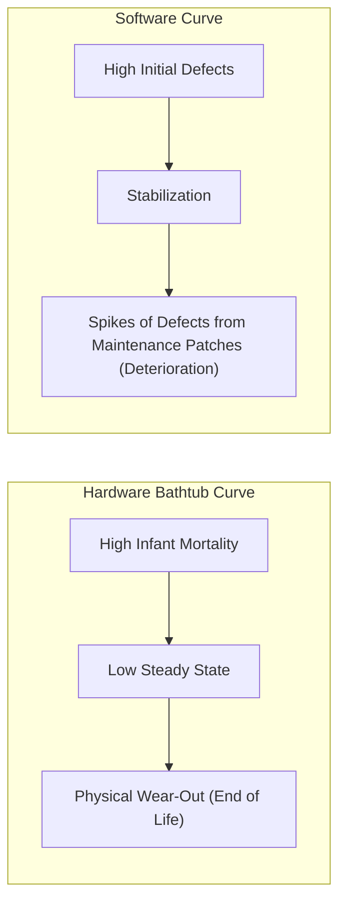
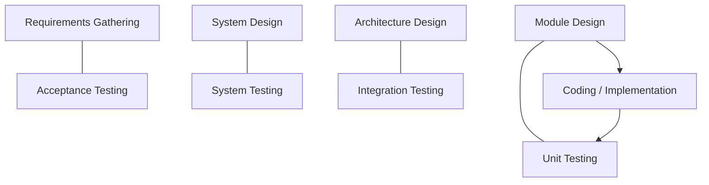
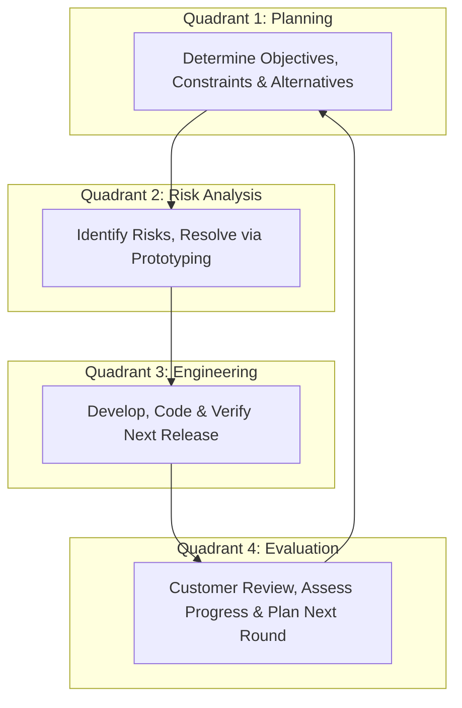
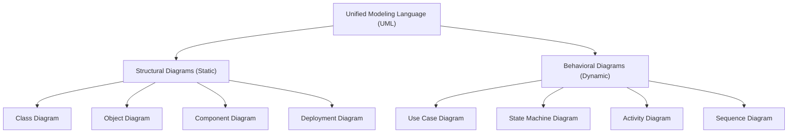

# 📦 Unit 1: Introduction to Software Engineering & Process Models

> **Source Traceability:** Extracted directly from course syllabus slides `SE unit 1.pdf`, Pages 1–89. Cross-referenced with Roger S. Pressman (_Software Engineering: A Practitioner's Approach_, Ch. 1–5) and Ian Sommerville (_Software Engineering_, Ch. 1–3).

---

## 🗺️ A. Topic Overview

### ✨ 1. What is this topic about?

Software Engineering (SE) is the application of systematic, disciplined, and quantifiable engineering principles to the development, operation, and maintenance of software. Instead of hacking code together, SE introduces structured **Software Development Life Cycle (SDLC) process models**—from sequential workflows (Waterfall, V-Model) to evolutionary and rapid paradigms (Prototyping, Spiral, RAD) and modern adaptive approaches (Agile, Scrum, XP). It also establishes visual architectural modeling using the **Unified Modeling Language (UML)**.

### ✨ 2. Why does it matter?

Without engineering methodologies, software projects inevitably suffer from the **Software Crisis**: massive budget overruns, missed deadlines, poor quality, and high maintenance costs. Understanding process models enables engineers to choose the right framework based on project volatility, risk profile, and customer availability.

### ✨ 3. Learning Objectives

By the end of this module, you will be able to:

- State the formal definitions of Software, Engineering, and Software Engineering.
- Contrast software deterioration with hardware wear-out (the Bathtub curve).
- Explain the 4 layers of Software Technology and the 3 generic phases (Definition, Development, Support).
- Compare and select among Waterfall, V-Model, Incremental, RAD, Prototyping, and Spiral models.
- Apply Agile principles and explain Scrum ceremonies, artifacts, and XP practices.
- Distinguish and draw UML Structural (Class, Object, Component, Deployment) and Behavioral (Use Case, Sequence, Activity, State Machine) diagrams.

---

## ✨ B. Explain Like I Am Learning It for the First Time

Imagine building a small wooden doghouse versus building an 80-story skyscraper.

- For a **doghouse**, you can buy some wood, a hammer, and nails, and build it in an afternoon. If a board is crooked, you just hammer another nail. That is **hobby programming**.
- For an **80-story skyscraper**, if you just start pouring concrete without blueprints, soil analysis, structural calculations, building permits, safety inspections, and coordinated plumbing/electrical teams, the building will collapse and kill people. That is **Software Engineering**.

Software is not just code written in a text editor. By definition:
$$\text{Software} = \text{Instructions (Code)} + \text{Data Structures} + \text{Documentation}$$

Just like physical civil construction requires distinct phases (architectural drawings, foundation, framing, inspection), software development requires **Process Models**—step-by-step recipes ensuring the final product works, arrives on time, stays within budget, and can be maintained for years.

---

## 📝 C. Detailed Exam Notes

### 📖 1. Fundamental Definitions & The Software Crisis

- **Software:** A collection of executable instructions (programs) that provide desired function and performance, data structures that enable the programs to adequately manipulate information, and descriptive documents that describe the operation and use of the programs.
- **Engineering:** The application of science, tools, and empirical methods to find cost-effective solutions to practical human problems.
- **Software Engineering (IEEE Definition):** _(1)_ The application of a systematic, disciplined, quantifiable approach to the development, operation, and maintenance of software; that is, the application of engineering to software. _(2)_ The study of approaches as in (1).
- **The Software Crisis:** A term coined in the late 1960s (NATO Software Engineering Conference 1968) referring to the severe difficulties encountered in delivering functional software on time and within budget. Symptoms included:
  - Projects running 200% over budget and years behind schedule.
  - Software unreliability and crash-prone systems.
  - Software that did not meet actual user needs.
  - Code that was so spaghetti-like that maintenance was virtually impossible.

### 📝 2. Characteristics of Software (Exam Favorite!)

Software differs fundamentally from physical hardware:

1. **Software is engineered or developed, not manufactured in the classical sense:** While both activities require high quality, software manufacturing involves copying digital bits (near-zero marginal cost), whereas hardware manufacturing involves physical materials, assembly lines, and physical tolerances.
2. **Software doesn't "wear out":**
   - **Hardware Wear-Out (Bathtub Curve):** Hardware exhibits a "bathtub curve." High failure rates early on (infant mortality/burn-in defects), followed by a long period of low, steady failure rate, and finally a steep rise in failures as mechanical friction, oxidation, and physical wear take over.
   - **Software Deterioration Curve:** Software is immune to environmental wear (rust, dust, friction). However, as changes and patches are applied during maintenance, uncoordinated side effects introduce new defects. Thus, the failure rate spikes after every patch, causing the software to **deteriorate** over time rather than wear out.
3. **Most software is custom-built, rather than assembled from pre-existing components:** Although component-based software engineering (CBSE) is growing, the vast majority of business logic is bespoke.



### ✨ 3. Layered Technology of Software Engineering

Software engineering is a layered technology:

1. **Quality Focus (The Bedrock):** Any engineering approach must rest on an organizational commitment to quality (TQM, Six Sigma, continuous improvement).
2. **Process Layer (The Glue):** Defines the framework of activities, milestones, deliverables, QA checkpoints, and management controls (e.g., SDLC models).
3. **Methods Layer (The 'How-To'):** Provides technical "how-to's" for building software—requirements analysis, design modeling, program construction, testing, and maintenance.
4. **Tools Layer (Automated Support):** Computer-Aided Software Engineering (CASE) tools that provide automated or semi-automated support for the process and methods.

```
+---------------------------------------+
|                TOOLS                  |  <-- Automated Support (CASE, IDEs)
+---------------------------------------+
|               METHODS                 |  <-- Technical "How-to" (UML, Testing)
+---------------------------------------+
|               PROCESS                 |  <-- Framework Activities & Milestones
+---------------------------------------+
|         A QUALITY FOCUS               |  <-- Bedrock Commitment to Quality
+---------------------------------------+
```

### ✨ 4. Generic View of Software Engineering: 3 Phases

1. **Definition Phase ("What"):** Focuses on identifying _what_ information is to be processed, _what_ function and performance are desired, _what_ system behavior can be expected, and _what_ validation criteria are required. Includes System Engineering, Requirements Analysis, and Project Planning.
2. **Development Phase ("How"):** Focuses on _how_ data are to be structured, _how_ function is to be implemented within the architecture, _how_ procedural details are implemented, _how_ interfaces are characterized, and _how_ testing will be performed. Includes Software Design, Coding, and Testing.
3. **Support / Maintenance Phase ("Change"):** Focuses on _change_ associated with error corrections, enhancements, and adaptations.
   - **4 Types of Software Maintenance (Mandatory for Exam):**
     1. _Corrective Maintenance:_ Diagnosing and fixing latent residual bugs discovered by users during operational use (~20% of effort).
     2. _Adaptive Maintenance:_ Modifying software to interface properly with a changing environment (new OS, new hardware, new database version, new regulations) (~25% of effort).
     3. _Perfective Maintenance:_ Enhancing software by adding user-requested features, improving computational efficiency, or enhancing usability (~50% of effort).
     4. _Preventive Maintenance:_ Re-engineering, restructuring, or refactoring code to prevent future errors and improve maintainability (Software Reverse Engineering) (~5% of effort).

---

### 🔄 5. Detailed Comparison of Process Models

#### 🔄 A. Waterfall Model (Linear Sequential Model / Classic Life Cycle)

- **Concept:** Suggested by Winston Royce (1970). Strictly linear sequential workflow: Communication -> Planning -> Modeling (Analysis & Design) -> Construction (Code & Test) -> Deployment & Maintenance.
- **Rules:** A phase must be completely finished and signed off before the next phase begins.
- **When to Use:** Requirements are well-understood, fixed, stable, and technology is mature.
- **Drawbacks:** Real projects rarely follow pure sequential flow; customer sees working software only at the very end ("Blocking state"); high risk of project failure if early requirements had errors.

#### 🔄 B. V-Model (Verification and Validation Model)

- **Concept:** Demonstrates the explicit relationship between early specification/design phases and subsequent testing phases.
- **Left Wing (Verification - "Are we building the product right?"):** Requirements Analysis -> System Design -> Architecture Design -> Module Design -> Coding.
- **Right Wing (Validation - "Are we building the right product?"):** Unit Testing (tests Module Design) -> Integration Testing (tests Architecture) -> System Testing (tests System Design) -> Acceptance Testing (tests Requirements).



#### 🔄 C. Incremental Process Model

- **Concept:** Delivers a series of releases called "increments." The first increment is the "core product" satisfying fundamental requirements. Subsequent increments add supplementary features.
- **Advantage:** Users get operational software quickly; early feedback guides future increments; lower risk of total project failure.

#### 🔄 D. RAD (Rapid Application Development) Model

- **Concept:** An incremental process model emphasizing an extremely short development cycle (typically 60 to 90 days). Uses component-based construction and automated CASE tools.
- **Prerequisites:** High modularity; massive human resource commitment (multiple parallel teams); clear, mature requirements.

#### 🔄 E. Prototyping Model

- **Concept:** When a customer has a general objective but cannot define detailed input/output requirements, an evolutionary prototype is built.
- **Phases:** Quick Communication -> Quick Plan -> Quick Modeling -> Construction of Prototype -> Customer Evaluation & Feedback -> Iteration.
- **Pros:** Excellent user involvement; clarifies ambiguous requirements.
- **Cons:** Customer mistakes the quick-and-dirty prototype for the final robust product ("Can't we just ship this?"); developer makes architectural compromises that become permanent technical debt.

#### 🔄 F. Spiral Model (Barry Boehm's Risk-Driven Model)

- **Concept:** An evolutionary process model that couples the iterative nature of prototyping with the controlled and systematic aspects of the waterfall model. It adds explicit **Risk Analysis**.
- **Structure:** Depicted as an expanding spiral divided into 4 quadrants:
  1. _Planning & Objective Setting:_ Determine objectives, alternatives, and constraints.
  2. _Risk Analysis & Mitigation:_ Identify and resolve technical and managerial risks (prototyping, simulation, benchmarking).
  3. _Engineering & Construction:_ Develop and verify next-level product.
  4. _Customer Evaluation:_ Review results with customer and plan next spiral iteration.
- **Real-World Case:** Used by Microsoft for major OS versions (Windows NT/2000), large defense applications.
- **Limitations:** Expensive, requires high risk-assessment expertise; if a major risk is missed, disaster ensues.



#### 🔄 G. Process Models Master Comparison Matrix

| Parameter                 | Waterfall             | Prototyping     | RAD                   | Spiral                   | Agile (Scrum)           |
| :------------------------ | :-------------------- | :-------------- | :-------------------- | :----------------------- | :---------------------- |
| **Requirement Stability** | Fixed / Clear         | Highly Unclear  | Well-Understood       | Can be Volatile          | Dynamic / Changing      |
| **Risk Handling**         | Poor (Late detection) | Moderate        | Low                   | **Excellent (Explicit)** | High (via fast sprints) |
| **Customer Involvement**  | Only start & end      | High throughout | High                  | High at each review      | Continuous daily/sprint |
| **Delivery Time**         | Very Long (at end)    | Quick prototype | Very Fast (60-90 d)   | Incremental              | Rapid (2-4 wk sprints)  |
| **Cost / Complexity**     | Low overhead          | Moderate        | High (multiple teams) | High (expert driven)     | Variable / Moderate     |

---

### ✨ 6. Agile Methodologies & Scrum Framework

#### ✨ The Agile Philosophy

Agility represents adaptability, swiftness, and continuous collaboration.
**The 4 Agile Manifesto Values (Must Memorize):**

1. **Individuals and interactions** over processes and tools.
2. **Working software** over comprehensive documentation.
3. **Customer collaboration** over contract negotiation.
4. **Responding to change** over following a plan.

#### ✨ Scrum Framework

- **Scrum Roles:**
  - _Product Owner (PO):_ Represents business/customer, maintains and prioritizes the Product Backlog.
  - _Scrum Master (SM):_ Servant leader, removes impediments, ensures Scrum practices are followed.
  - _Development Team:_ Self-organizing, cross-functional group of 5–9 professionals who build the increment.
- **Scrum Artifacts:**
  - _Product Backlog:_ Prioritized master list of all user stories and requirements.
  - _Sprint Backlog:_ Subset of user stories committed for completion in the current sprint.
  - _Increment (Burn-down chart):_ Potentially shippable working product.
- **Scrum Ceremonies:**
  - _Sprint Planning:_ Selecting items from Product Backlog to form the Sprint Backlog.
  - _Daily Scrum (Stand-up):_ 15-minute daily check-in (What did I do yesterday? What will I do today? What blockers exist?).
  - _Sprint Review:_ Demo of working software to stakeholders.
  - _Sprint Retrospective:_ Internal team review of process improvements for the next sprint.

#### 💻 Extreme Programming (XP) Practices

- **Pair Programming:** Two programmers at one workstation (one Driver writing code, one Navigator reviewing/thinking strategically).
- **Test-Driven Development (TDD):** Writing automated unit tests before writing functional code.
- **Continuous Integration (CI):** Code integrated and tested multiple times a day.
- **Refactoring:** Constant restructuring to improve design without altering behavior.

---

### 🔄 7. Unified Modeling Language (UML)

UML is the industry standard visual language for specifying, visualizing, constructing, and documenting software artifacts.



#### ✨ Structural Diagrams

1. **Class Diagram:** Visualizes static structure: classes, attributes (`+` public, `-` private, `#` protected), operations, and relationships (Association, Aggregation, Composition, Inheritance/Generalization).
2. **Object Diagram:** Snapshot of the system at a specific runtime moment, showing actual instances with values.
3. **Component Diagram:** Illustrates software pieces, embedded controllers, libraries, and their interface dependencies.
4. **Deployment Diagram:** Maps software artifacts to physical hardware nodes (e.g., application server, database server, mobile client).

#### ✨ Behavioral Diagrams

1. **Use Case Diagram:** Shows system boundaries, external Actors (stick figures), and Use Cases (ellipses) representing functional goals.
2. **Sequence Diagram:** Shows time-ordered message exchange between interacting object lifelines.
3. **Activity Diagram:** Flowchart-like diagram depicting procedural workflow, decision points, and parallel fork/join execution.
4. **State Machine Diagram:** Depicts the lifecycle of an object as it transitions through various states in response to external events.

---

## 📝 D. Worked Examples

### 🔄 Example 1: Selecting a Process Model for an Exam Scenario

**Problem Statement:** A healthcare startup wants to build a patient monitoring system that integrates with hospital ICUs. The basic requirements are known, but hardware sensor APIs change frequently, and medical liability is catastrophic if failure occurs. Which SDLC model should they choose and why?
**Solution & Justification:**

1. **Selection:** Barry Boehm's **Spiral Model**.
2. **Justification:**
   - _High Technical & Regulatory Risk:_ The system interfaces with human life-support hardware; failure is catastrophic. The Spiral Model is explicitly risk-driven.
   - _Changing Hardware Interfaces:_ Prototyping activities in Quadrant 2 resolve sensor integration risks early before full-scale coding.
   - _Formal Checkpoints:_ Every spiral cycle requires evaluation and formal sign-off, fulfilling strict healthcare regulatory audits.

---

## ✨ E. Code and Practical Implementation

### ✨ Practical Python Implementation: Scrum Sprint Backlog & Velocity Calculator

This runnable script models user story point estimation, sprint capacity allocation, and burndown tracking.

```python
"""
Scrum Sprint Planning & Velocity Tracker
Author: Exam Revision Tutor
Language: Python 3.10+
"""

from dataclasses import dataclass
from typing import List

@dataclass
class UserStory:
    id: str
    title: str
    story_points: int
    status: str = "To Do"  # To Do, In Progress, Done

class Sprint:
    def __init__(self, sprint_number: int, team_capacity: int):
        self.sprint_number = sprint_number
        self.team_capacity = team_capacity
        self.stories: List[UserStory] = []

    def add_story(self, story: UserStory) -> bool:
        current_load = sum(s.story_points for s in self.stories)
        if current_load + story.story_points <= self.team_capacity:
            self.stories.append(story)
            print(f"[SUCCESS] Added '{story.title}' ({story.story_points} pts)")
            return True
        else:
            print(f"[REJECTED] '{story.title}' exceeds sprint capacity! ({current_load + story.story_points}/{self.team_capacity})")
            return False

    def complete_story(self, story_id: str):
        for s in self.stories:
            if s.id == story_id:
                s.status = "Done"
                print(f"[UPDATE] Story {story_id} marked as Done.")
                return
        print(f"[ERROR] Story {story_id} not found.")

    def calculate_velocity(self) -> int:
        return sum(s.story_points for s in self.stories if s.status == "Done")

    def print_burndown_summary(self):
        committed = sum(s.story_points for s in self.stories)
        delivered = self.calculate_velocity()
        remaining = committed - delivered
        print("\n<mark>= Sprint Summary </mark>=")
        print(f"Sprint: #{self.sprint_number} | Capacity: {self.team_capacity}")
        print(f"Committed Points: {committed} | Delivered: {delivered} | Burndown Remaining: {remaining}")
        print(f"Sprint Health: {'SUCCESS' if remaining == 0 else 'SPILLOVER'}\n")

# Execution Trace / Test Run
if __name__ == "__main__":
    sprint_1 = Sprint(sprint_number=1, team_capacity=20)

    # Adding User Stories
    sprint_1.add_story(UserStory("US-101", "User Login & JWT Auth", 5))
    sprint_1.add_story(UserStory("US-102", "Profile Management", 8))
    sprint_1.add_story(UserStory("US-103", "Stripe Payment Gateway", 5))
    sprint_1.add_story(UserStory("US-104", "AI Chatbot Integration", 8))  # Should reject

    # Simulating Sprint Execution
    sprint_1.complete_story("US-101")
    sprint_1.complete_story("US-102")
    # US-103 remains incomplete

    sprint_1.print_burndown_summary()
```

---

## ✨ F. Memory and Understanding Techniques

### 📝 1. Mnemonics for Exam Recall

- **Layered Technology Layers:** **"Q-P-M-T"** -> **Q**uality focus, **P**rocess, **M**ethods, **T**ools.
- **4 Types of Maintenance:** **"C-A-P-P"** -> **C**orrective, **A**daptive, **P**erfective, **P**reventive.
- **Generic SE Phases:** **"3 D's"** -> **D**efinition (What), **D**evelopment (How), **D**elivered Support (Change).
- **Agile Manifesto Values:** **"I-W-C-R"** -> **I**ndividuals, **W**orking software, **C**ustomer collaboration, **R**esponding to change.

### ✨ 2. Common Confusion Clarifier

| Often Confused Concepts | Waterfall vs Incremental                                                                                                           | Prototyping vs Spiral                                                                                                       |
| :---------------------- | :--------------------------------------------------------------------------------------------------------------------------------- | :-------------------------------------------------------------------------------------------------------------------------- |
| **Core Distinction**    | Waterfall delivers 100% of software at the very end. Incremental delivers usable pieces (Increments 1, 2, 3) at regular intervals. | Prototyping focuses on clarifying _requirements_. Spiral focuses on mitigating _risks_ through structured iterative cycles. |

---

## 📝 G. Additional Important Knowledge & Exam Tips

- **Core Syllabus:** The difference between software and hardware failure curves is tested almost every semester. Remember: **Hardware wears out due to physical friction; software deteriorates due to maintenance side-effects**.
- ** Answer Structuring:**
  - _For a 2-mark question on Software Crisis:_ Give definition (NATO 1968) + 2 key symptoms.
  - _For a 4-mark question on V-Model:_ Draw the V diagram showing verification on the left, coding at the base, and validation levels on the right.
  - _For a 5-mark question on Spiral Model:_ Draw the 4 quadrants, name Barry Boehm, and describe the 4 activities step by step.

---

## 📝 H. Quick Revision & Rapid Recall

### 🧾 5-Point Summary

1. Software is instructions, data structures, and documentation; it does not wear out but deteriorates under change.
2. The 4 layers of SE are Quality, Process, Methods, and Tools.
3. The 4 types of maintenance are Corrective (bugs), Adaptive (environment change), Perfective (new features), and Preventive (refactoring).
4. Waterfall is linear sequential; V-Model maps development to testing; Spiral is risk-driven; RAD is high-speed (60-90 days); Agile is adaptive.
5. UML diagrams split into Structural (Class, Object, Component, Deployment) and Behavioral (Use Case, Sequence, Activity, State).

### ❓ Rapid-Recall Flash Questions

1. _Q: What are the two wings of the V-Model?_  
   **A:** Left wing is Verification ("building it right"), right wing is Validation ("building the right thing").
2. _Q: What is the primary driving factor of the Spiral Model?_  
   **A:** Risk Analysis and Risk Management (Barry Boehm).
3. _Q: Name the 4 ceremonies of Scrum._  
   **A:** Sprint Planning, Daily Scrum, Sprint Review, Sprint Retrospective.
4. _Q: Which maintenance type consumes ~50% of maintenance effort?_  
   **A:** Perfective maintenance (adding new user features).
5. _Q: What does a UML Deployment diagram represent?_  
   **A:** The mapping of software artifacts onto physical hardware nodes and execution environments.

---

## 🧠 Interactive Practice Quiz (Self-Test Before Looking at Answers!)

### ❓ Question 1 (MCQ)

Which process model is most suitable for a project where requirements are completely understood, stable, and technological risk is nearly non-existent?

- A) Spiral Model
- B) Prototyping Model
- C) Waterfall Model
- D) Agile Scrum

### ❓ Question 2 (Trap Question)

_True or False:_ Software wears out over time due to wear, tear, and friction just like computer hardware.

### ❓ Question 3 (MCQ)

Refactoring legacy code to improve internal structure and readability without changing its external behavior is classified under which maintenance category?

- A) Corrective Maintenance
- B) Adaptive Maintenance
- C) Perfective Maintenance
- D) Preventive Maintenance

---

<details>
<summary><b>💡 Click to Reveal Quiz Solutions & Trap Explanations</b></summary>

### 💡 Quiz Answers & Trap Explanations

1. **Answer: C (Waterfall Model)**  
   _Why others are wrong:_ Spiral is intended for high-risk projects; Prototyping is for vague requirements; Agile is designed for rapidly shifting requirements.
2. **Answer: FALSE (Common Exam Trap!)**  
   _Explanation:_ Software does NOT wear out. It deteriorates over time because maintenance modifications introduce side effects and degrade architectural integrity.
3. **Answer: D (Preventive Maintenance)**  
   _Explanation:_ Corrective fixes bugs; Adaptive adapts to environment changes; Perfective adds customer features; Preventive refactors to prevent future problems.

</details>
