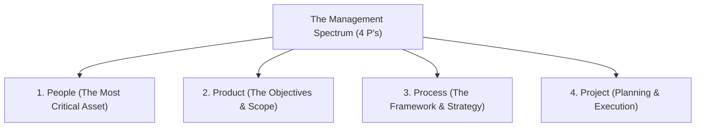
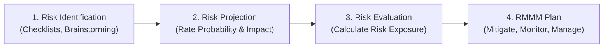

# 📊 Unit 2: Software Project Management

> **Source Traceability:** Extracted directly from course syllabus slides `SE unit 2.pdf`, Pages 1–23. Cross-referenced with Pressman (Ch. 24, 27, 28) and Sommerville (Ch. 22–24).

---

## A. Topic Overview

### 1. What is this topic about?
Software Project Management (SPM) is the art and science of planning, organizing, monitoring, and controlling software projects to achieve business objectives within defined constraints of **Time, Cost, and Quality**. It covers the **Management Spectrum (The 4 P's)**, Barry Boehm's **W5HH Principle**, team organizational structures, and formal **Risk Management (Identification, Assessment, Control, and RMMM)**.

### 2. Why does it matter?
A project with brilliant programmers will still fail catastrophically if requirements are miscommunicated, schedules are arbitrary, risks are ignored, or team roles are undefined. SPM ensures projects deliver business value predictably.

### 3. Learning Objectives
- Define Software Project Management and analyze its triple constraints.
- Explain the 4 P's of the Management Spectrum (People, Product, Process, Project).
- Memorize and apply Barry Boehm's W5HH principle.
- Conduct Risk Analysis: Identification, Projection, Mitigation, Monitoring, and Management (RMMM).
- Identify Key Performance Indicators (KPIs) and project tracking tools (JIRA, Trello).

---

## B. Explain Like I Am Learning It for the First Time

Imagine you and five friends decide to open a gourmet restaurant.
- You can't just run into the kitchen and start frying onions.
- You must ask: Who is cooking? Who is serving? (That's **People**).
- What dishes are on the menu? What ingredients do we need? (That's **Product**).
- How do orders flow from table to kitchen to billing? (That's **Process**).
- How much money do we have? When do we open? How do we prevent running out of cash? (That's **Project**).

If the chef gets sick, what is backup plan? That is **Risk Management**. In software, SPM is the master coordinator ensuring that your engineering effort finishes on time, within budget, and doesn't crash on launch day.

---

## C. Detailed Exam Notes

### 1. The Management Spectrum: The 4 P's (Core Exam Question)
Effective software management focuses on four essential dimensions:



1. **People (The Most Important Element):**
   - Software development is an intensely human-centric endeavor.
   - *Key Players:* Business Managers, Project Managers, Technical Leads, Software Engineers, and End Users.
   - *Team Structures:*
     - *Democratic Decentralized (DD):* No permanent leader; decisions made by consensus; high communication overhead; ideal for difficult, research-oriented problems.
     - *Controlled Centralized (CC):* Top-down authority (Chief Programmer Team); leader plans and directs; low communication overhead; ideal for simple, routine problems.
     - *Controlled Decentralized (CD):* Hierarchical sub-teams with local autonomy; combines coordination with flexibility.
2. **Product (Objectives & Scope):**
   - Before planning begins, product objectives and scope must be established.
   - *Problem Decomposition:* Breaking down complex software goals into smaller functional components (Partitioning).
3. **Process (The Framework):**
   - The choice of process model (Waterfall, Agile, Spiral) suitable for the product and team.
   - Decomposes the project into framework activities and umbrella activities.
4. **Project (Planning & Tracking):**
   - Directing the activities required to build the product: effort estimation, risk analysis, scheduling, tracking milestones, and controlling scope creep.

---

### 2. Barry Boehm's W5HH Principle (100% Guaranteed Exam Topic)
Dr. Barry Boehm established an intuitive, powerful decision-making framework formulated as 7 questions that summarize the essence of any software project:

| Question | Core Objective | Key Deliverables & Focus |
| :--- | :--- | :--- |
| **1. Why is the system being developed?** | Business Justification | Validates whether the business goals justify the capital expenditure. |
| **2. What will be done?** | Scope & Functionality | Establishes the functional requirements, constraints, and boundaries. |
| **3. When will it be done?** | Timeline & Milestones | Defines project schedule, critical path, and delivery deadlines. |
| **4. Who is responsible?** | Organization & Roles | Identifies roles: Project Manager, Lead Architect, Developers, QA, PO. |
| **5. Where are they located?** | Spatial & Geographical Distribution | Coordinates co-located vs distributed / offshore development teams. |
| **6. How will the job be done?** | Technical & Managerial Strategy | Selects SDLC process model, tech stack, testing strategy, and QA standards. |
| **7. How much of each resource is needed?** | Resource Allocation | Quantifies effort (person-months), budget (\$ cost), hardware, licenses, and office space. |

---

### 3. Software Risk Management

A **Risk** is a potential future problem that may occur with a certain probability and cause an undesirable impact on the project.
$$\text{Risk Exposure (RE)} = P \times I$$
*(where $P$ is probability of occurrence and $I$ is financial or schedule impact).*

#### The 4 Categories of Risk
1. **Project Risks:** Threaten project schedule and budget (e.g., turnover of experienced developers, unrealistic deadlines).
2. **Technical Risks:** Threaten the quality and timeliness of the software (e.g., untried algorithms, immature third-party APIs, ambiguous requirements).
3. **Business Risks:** Threaten the commercial viability of the product (e.g., market risk: nobody buys the product; strategic risk: product no longer fits company strategy).
4. **Known vs Predictable vs Unpredictable Risks:**
   - *Known:* Uncovered after careful evaluation (e.g., unrealistic delivery date).
   - *Predictable:* Extrapolated from past project experience (e.g., staff turnover).
   - *Unpredictable:* Black swan events (e.g., sudden vendor bankruptcy, hardware supply chain disruption).

#### Formal Risk Management Process: RMMM Plan
**RMMM stands for: Risk Mitigation, Monitoring, and Management.**
- **Mitigation (Prevention):** Proactive steps taken before the risk materializes to reduce probability (e.g., to mitigate high staff turnover: cross-train team members, maintain clear documentation, offer retention bonuses).
- **Monitoring (Tracking):** Continually tracking risk indicators during the project (e.g., tracking team morale, monitoring bug discovery rates).
- **Management (Contingency):** The reactive disaster recovery plan executed when the risk actually happens (e.g., hiring certified contractors if a key architect departs).



---

### 4. Project Monitoring & Key Performance Indicators (KPIs)
A project monitoring plan ensures that discrepancies between planned and actual performance are detected early.
- **Key Metrics / KPIs:**
  - *Schedule Variance (SV):* Planned Time vs Actual Time taken.
  - *Effort Variance (EV):* Planned Person-Hours vs Actual Person-Hours logged.
  - *Defect Density:* Defects found per KLOC or Function Point.
  - *Velocity (in Agile):* Story points completed per sprint.
- **Tools & Platforms:**
  - **JIRA:** Industry standard for Agile tracking, sprint backlogs, bug tracking, and burndown charts.
  - **Trello:** Visual Kanban board for workflow states.
  - **MS Project:** Traditional Gantt charts and critical path analysis (CPA).

---

## D. Worked Examples

### Example 1: Risk Exposure Calculation (Exam Style)
**Scenario:** A software project is integrating a third-party payment gateway.
- *Risk 1 (Vendor API Delay):* Probability $P = 40\% = 0.40$. Impact: Delay cost $I = \$50,000$.
- *Risk 2 (Database Data Corruption):* Probability $P = 5\% = 0.05$. Impact: Recovery cost $I = \$300,000$.
Calculate the Risk Exposure ($RE$) for both risks and determine which should receive higher mitigation priority.

**Step-by-step Solution:**
1. Formula: $RE = P \times I$
2. For Risk 1: $RE_1 = 0.40 \times \$50,000 = \$20,000$.
3. For Risk 2: $RE_2 = 0.05 \times \$300,000 = \$15,000$.
4. **Decision:** Even though Risk 2 has a much larger raw impact, **Risk 1 has a higher Risk Exposure (\$20,000 vs \$15,000)** due to its high probability. Project management must prioritize mitigating Risk 1 (e.g., building mock payment sandbox stubs).

---

## E. Practical Implementation: Risk Register Tracker in Python

```python
"""
Software Risk Exposure & Priority Calculator
Author: Exam Revision Tutor
Language: Python 3.10+
"""

from dataclasses import dataclass
from typing import List

@dataclass
class RiskItem:
    id: str
    description: str
    category: str  # Project, Technical, Business
    probability: float  # 0.0 to 1.0
    impact_dollars: float

    @property
    def risk_exposure(self) -> float:
        return round(self.probability * self.impact_dollars, 2)

class RiskRegister:
    def __init__(self):
        self.risks: List[RiskItem] = []

    def add_risk(self, risk: RiskItem):
        self.risks.append(risk)

    def print_prioritized_register(self):
        # Sort by Risk Exposure descending
        sorted_risks = sorted(self.risks, key=lambda r: r.risk_exposure, reverse=True)
        print("\n<mark>= PRIORITIZED SOFTWARE RISK REGISTER </mark>=")
        print(f"{'ID':<6} | {'Category':<10} | {'Prob':<6} | {'Impact ($)':<10} | {'Exposure ($)':<12} | {'Description'}")
        print("-" * 75)
        for r in sorted_risks:
            print(f"{r.id:<6} | {r.category:<10} | {r.probability:<6.2f} | {r.impact_dollars:<10.0f} | {r.risk_exposure:<12.2f} | {r.description}")
        print("-" * 75)

if __name__ == "__main__":
    register = RiskRegister()
    register.add_risk(RiskItem("RSK-01", "Lead architect departs team", "Project", 0.30, 80000))
    register.add_risk(RiskItem("RSK-02", "Cloud service outage during deployment", "Technical", 0.10, 150000))
    register.add_risk(RiskItem("RSK-03", "Payment API changes specification", "Technical", 0.50, 40000))
    register.add_risk(RiskItem("RSK-04", "Competitor launches clone app early", "Business", 0.20, 120000))

    register.print_prioritized_register()
```

---

## F. Memory and Understanding Techniques

### 1. Mnemonics
- **The 4 P's of Management:** **"People Produce Processed Projects"** -> **P**eople, **P**roduct, **P**rocess, **P**roject.
- **RMMM Strategy:** **"M-M-M"** -> **M**itigate (Prevent), **M**onitor (Watch), **M**anage (Recover).
- **The 3 Needs of SPM:** **"T-C-Q"** -> **T**ime, **C**ost, **Q**uality.

---

## G. Common Mistakes & Exam Tips
- **Mistake:** Forgetting the difference between Risk Mitigation and Risk Management.
  *Tip:* **Mitigation** happens *before* the disaster (preventative vaccine). **Management** happens *after* the disaster strikes (emergency treatment).
- **Exam Tip (5 Marks):** If asked to explain the **W5HH Principle**, write all 7 questions, give the author's name (**Barry Boehm**), and write 1 sentence explaining the software management significance of each question.

---

## H. Quick Revision & Rapid Recall

### 5-Point Summary
1. SPM balances the triple constraints: Time, Cost, and Quality.
2. The 4 P's are People (human capital), Product (scope & goals), Process (SDLC activities), and Project (planning & control).
3. Barry Boehm's W5HH principle asks Why, What, When, Who, Where, How, and How Much.
4. Risk Exposure is calculated as $P \times I$ (Probability $\times$ Impact).
5. RMMM plan encompasses Risk Mitigation (prevention), Monitoring (tracking), and Management (contingency).

### Rapid-Recall Flash Questions
1. *Q: What are the 4 P's in the software management spectrum?*  
   **A:** People, Product, Process, Project.
2. *Q: Who proposed the W5HH principle?*  
   **A:** Dr. Barry Boehm.
3. *Q: What does RMMM stand for?*  
   **A:** Risk Mitigation, Monitoring, and Management.
4. *Q: How is Risk Exposure mathematically calculated?*  
   **A:** $RE = \text{Probability} \times \text{Impact}$.
5. *Q: What are the 3 major team organizational structures?*  
   **A:** Democratic Decentralized (DD), Controlled Centralized (CC), and Controlled Decentralized (CD).

---

## 🧠 Interactive Practice Quiz

### Question 1 (MCQ)
Which of the following is an example of a **Project Risk** rather than a Technical or Business risk?
- A) The cloud database does not support required concurrency.
- B) A competitor releases a similar software product for free.
- C) Two senior software developers resign during critical sprint.
- D) The client company undergoes executive restructuring.

### Question 2 (Trap Question)
*True or False:* A risk with a catastrophic impact of \$1,000,000 must always be mitigated before a risk with an impact of \$50,000.

---


<details>
<summary><b>💡 Click to Reveal Quiz Solutions & Trap Explanations</b></summary>

### 💡 Quiz Answers & Trap Explanations
1. **Answer: C (Developers resign)**  
   *Explanation:* Staff turnover directly threatens the project schedule and budget (Project Risk). Option A is a Technical Risk, Option B is a Business Risk.
2. **Answer: FALSE (Exam Trap!)**  
   *Explanation:* Mitigation priority depends on **Risk Exposure ($P \times I$)**, not raw impact alone. If the \$1M risk has a 0.001% probability ($RE = \$10$), and the \$50k risk has an 80% probability ($RE = \$40,000$), the \$50k risk receives higher priority!

</details>
