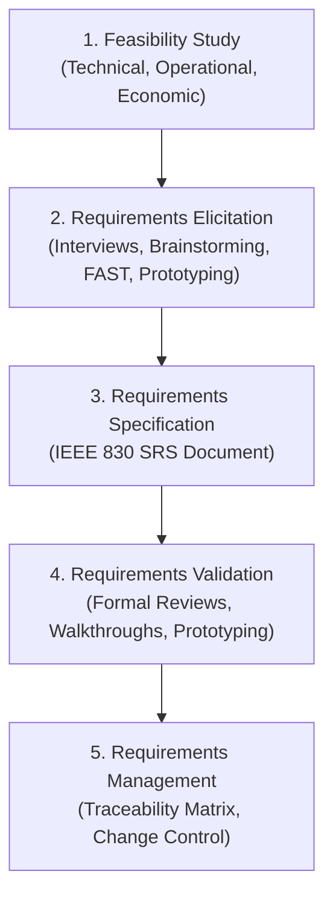
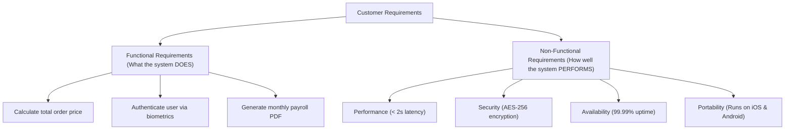
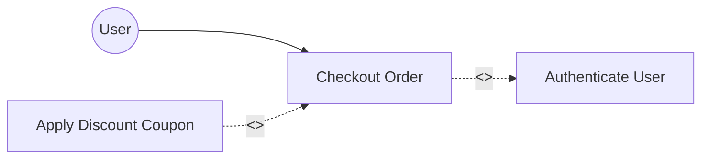

# 📋 Unit 3: Requirements Engineering

> **Source Traceability:** Extracted directly from course syllabus slides `SE unit 3.pdf`, Pages 1–32. Cross-referenced with Pressman (Ch. 5–8) and Sommerville (Ch. 4–5).

---

## 🗺️ A. Topic Overview

### ✨ 1. What is this topic about?
Requirements Engineering (RE) is the disciplined process of discovering, analyzing, documenting, validating, and maintaining software requirements throughout the system lifecycle. It bridges the communication gap between non-technical business stakeholders and software engineers. This unit covers the **5-step RE process**, **Feasibility Studies (T-O-E)**, the **Software Requirements Specification (SRS) IEEE 830 standard**, **Functional vs Non-Functional Requirements**, **Use Case modeling (`<<include>>`, `<<extend>>`)**, and **Analysis Modeling (Context Diagrams, DFDs, ERDs)**.

### ✨ 2. Why does it matter?
Industry studies (Standish Group CHAOS Report) prove that over **50% of software project failures** stem from flawed requirements: incomplete specifications, unrealistic user expectations, and uncontrolled scope creep. Fixing a requirements defect during post-release maintenance costs up to **100 times more** than fixing it during requirements analysis!

---

## ✨ B. Explain Like I Am Learning It for the First Time

Imagine hiring an architect to build your dream home:
- If you simply say: *"Build me a modern, spacious house,"* the architect might design a minimalist glass cube with 1 bedroom and 4 living rooms.
- But you have a spouse, three kids, and two dogs! You needed 4 bedrooms, a fenced yard, and a soundproof office.
- The phrase *"modern, spacious house"* was an ambiguous, vague requirement.

Requirements Engineering is the process of sitting down with you and asking the exact questions:
- *How many rooms?* (Functional requirement)
- *Must the roof withstand hurricane-force winds?* (Non-functional requirement)
- *Can this be built on your budget?* (Economic feasibility)
- *Does local city zoning permit a 3-story structure?* (Operational/Legal feasibility)

Everything agreed upon is written into a binding contract: the **Software Requirements Specification (SRS)**.

---

## 📝 C. Detailed Exam Notes

### 🔄 1. The 5-Step Requirements Engineering Process (Core Exam Topic)



#### 🧗 Step 1: Feasibility Study (T-O-E Dimensions)
Assesses whether the project is worth initiating:
1. **Technical Feasibility:** Do we possess the necessary hardware, software, networking technology, and developer skills?
2. **Operational Feasibility:** Will the solution integrate smoothly into existing business workflows? Will employees resist using it?
3. **Economic Feasibility (Cost-Benefit Analysis):** Does the projected financial return (ROI, cost savings) justify the development and maintenance expenditure?

#### 📚 Step 2: Requirements Elicitation
Techniques for discovering what users actually need:
- *Interviews (Structured vs Unstructured):* Direct questioning of stakeholders.
- *Questionnaires & Surveys:* Cost-effective for gathering input from thousands of distributed users.
- *FAST (Facilitated Application Specification Techniques):* Joint customer-developer workshops held in a neutral environment.
- *Brainstorming Sessions:* Creative idea generation without early criticism.
- *Prototyping:* Building tangible mockups to elicit feedback on ambiguous user interfaces.

#### 📋 Step 3: Requirements Specification (The SRS Document)
Documenting requirements formally. Conforms to the **IEEE 830 Standard**.

#### 📋 Step 4: Requirements Validation & Verification
- **Verification:** "Have we built the specification right?" (Conforms to internal standards).
- **Validation:** "Have we specified the right system?" (Matches true customer intent).
- *Validation Techniques:*
  1. *Formal Requirement Reviews:* A committee of clients, analysts, and developers examines the text line by line.
  2. *Walkthroughs:* An informal review where the author walks a small peer group through the document.
  3. *Prototyping:* Demonstrating an interactive mock-up to validate user workflows.

#### 📊 Step 5: Requirements Management
Managing requirement evolution and changes using a **Requirements Traceability Matrix (RTM)** to map every requirement to its design, code, and test cases.

---

### 📚 2. Characteristics of a High-Quality SRS (IEEE 830 Standard)
A good SRS document must possess these 7 attributes (frequently tested in 4-mark questions):
1. **Unambiguous:** Every requirement has exactly one interpretation.
2. **Complete:** Contains all essential requirements (functional, performance, constraints).
3. **Consistent:** No requirement contradicts another requirement.
4. **Verifiable / Testable:** A quantifiable test can be designed to verify compliance (e.g., *"System responds within 2.0 seconds"* is verifiable; *"System must be fast"* is NOT).
5. **Modifiable:** Well-structured with table of contents and cross-references so changes can be made easily.
6. **Traceable:** Each requirement has a unique identifier (e.g., `REQ-F-101`) traceable through design, code, and test cases.
7. **Ranked for Importance / Stability:** Requirements are prioritized (e.g., Essential, Desirable, Optional).

---

### 📋 3. Functional vs Non-Functional Requirements



| Dimension | Functional Requirements | Non-Functional Requirements |
| :--- | :--- | :--- |
| **Definition** | Specifies functions and services the system *must perform*. | Specifies system quality attributes, performance constraints, and standards. |
| **Answers** | "What does the software do?" | "How well does the software do it?" |
| **Examples** | Login, generate invoices, process credit cards. | Response time, throughput, security, 99.9% availability, fault tolerance. |
| **Failure Result** | System cannot perform designated tasks. | System works, but is unusable, slow, insecure, or hard to maintain. |

---

### 🔄 4. Use Case Modeling: Relationships & Notations

A **Use Case Diagram** depicts functional interaction between external **Actors** and the **System Boundary**.

#### ❓ Use Case Relationships (Guaranteed Exam Question!)
1. **`<<include>>` Relationship (Mandatory Sub-task):**
   - Represents compulsory common functionality extracted from multiple use cases.
   - The base use case *cannot complete* without executing the included use case.
   - *Example:* `Checkout Order` $\xrightarrow{<<include>>}$ `Authenticate User`.
   - *Notation:* Dashed arrow pointing from Base Use Case $\rightarrow$ Included Use Case.
2. **`<<extend>>` Relationship (Optional / Conditional Behavior):**
   - Represents optional or exceptional behavior executed only under specific extension conditions.
   - The base use case is complete on its own without the extension.
   - *Example:* `Calculate Total Bill` $\xleftarrow{<<extend>>}$ `Apply VIP Discount Coupon`.
   - *Notation:* Dashed arrow pointing from Extending Use Case $\rightarrow$ Base Use Case.
3. **Generalization:**
   - Inheritance between actors or between use cases.
   - *Example:* Actor `Manager` inherits from Actor `Employee`.



---

### 🔄 5. Requirements Analysis & Modeling: DFD & ERD

#### ✨ Data Flow Diagrams (DFDs)
Visualizes how data moves through operational transformations:
- **Level 0 DFD (Context Diagram):** Entire software system is represented as a single central process bubble surrounded by external entities and input/output data flows.
- **Level 1 DFD:** Decomposes the central bubble into major functional subsystems.
- **DFD Symbols (Gane & Sarson / DeMarco):**
  - *Process:* Circle or rounded rectangle (transforms incoming data to outgoing data).
  - *Data Store:* Two parallel horizontal lines (file, database table).
  - *External Entity:* Rectangle (external user, sensor, bank system).
  - *Data Flow:* Directed arrow carrying labeled data packets.

#### ✨ Entity-Relationship Diagram (Peter Chen, 1976)
- **Entities:** Real-world object or concept (represented by a Rectangle).
- **Weak Entity:** An entity that cannot be uniquely identified by its own attributes alone (represented by a Double Rectangle).
- **Attributes:** Properties of an entity (represented by an Ellipse):
  - *Key Attribute:* Underlined text.
  - *Multi-valued Attribute:* Double Ellipse (e.g., `phone_numbers`).
  - *Derived Attribute:* Dashed Ellipse (e.g., `age` derived from `date_of_birth`).
  - *Composite Attribute:* Tree of sub-ellipses (e.g., `Name` $\rightarrow$ `First`, `Last`).
- **Relationships:** Associations between entities (represented by a Diamond).

---

## 📋 D. Worked Examples: Complete Use Case Specification
**Use Case:** Transfer Funds via Online Banking
- **Primary Actor:** Bank Customer
- **Preconditions:** Customer is authenticated; source account has sufficient funds.
- **Main Success Scenario (Happy Path):**
  1. Customer selects source account and enters beneficiary account details.
  2. Customer inputs transfer amount.
  3. System validates account numbers and available balance.
  4. System executes `<<include>>` `Verify OTP / 2FA`.
  5. System debits source account and credits destination account.
  6. System issues digital transaction receipt.
- **Extensions (Alternative Flows):**
  - *3a. Insufficient funds:* System displays error and prompts customer to re-enter amount.
  - *4a. OTP verification fails:* System locks transaction after 3 invalid attempts.

---

## 📋 E. Code Implementation: Requirement Traceability Matrix (RTM) Validator

```python
"""
Requirement Traceability Matrix (RTM) Validator
Author: Exam Revision Tutor
Language: Python 3.10+
"""

class RequirementTraceabilityMatrix:
    def __init__(self):
        self.matrix = {}

    def add_trace(self, req_id: str, desc: str, design_module: str, code_file: str, test_id: str):
        self.matrix[req_id] = {
            "description": desc,
            "design": design_module,
            "code": code_file,
            "test": test_id
        }

    def verify_coverage(self):
        print("\n<mark>= REQUIREMENTS TRACEABILITY AUDIT </mark>=")
        untested = []
        unimplemented = []
        for req_id, details in self.matrix.items():
            if not details["code"]:
                unimplemented.append(req_id)
            if not details["test"]:
                untested.append(req_id)
            print(f"[{req_id}] {details['description']} -> Module: {details['design']} | Code: {details['code']} | Test: {details['test']}")

        print("-" * 60)
        if not untested and not unimplemented:
            print("[STATUS] 100% Traceability Coverage Verified!")
        else:
            print(f"[WARNING] Unimplemented Requirements: {unimplemented}")
            print(f"[WARNING] Untested Requirements: {untested}")

if __name__ == "__main__":
    rtm = RequirementTraceabilityMatrix()
    rtm.add_trace("REQ-01", "User Biometric Login", "AuthModule", "auth.py", "TC-AUTH-01")
    rtm.add_trace("REQ-02", "Export Monthly PDF Statement", "ReportModule", "reports.py", "TC-REP-05")
    rtm.add_trace("REQ-03", "Auto SMS Notification", "NotifyModule", "", "TC-NOTIF-02")  # Missing code!
    
    rtm.verify_coverage()
```

---

## ✨ F. Memory and Understanding Techniques

### ✨ 1. Mnemonics
- **Feasibility Dimensions:** **"T-O-E"** -> **T**echnical, **O**perational, **E**conomic.
- **Characteristics of Good SRS:** **"C-U-C-V-T"** -> **C**omplete, **U**nambiguous, **C**onsistent, **V**erifiable, **T**raceable.
- **Include vs Extend:**
  - **IN**clude = **IN**dispensable (Always executed).
  - **EX**tend = **EX**tra (Only executed if condition met).

---

## 📝 G. Common Mistakes & Exam Tips
- **The Include vs Extend Arrow Direction Trap:**
  - For `<<include>>`: Arrow points **FROM Base Use Case TO Included Use Case** (`Base` $\rightarrow$ `Included`).
  - For `<<extend>>`: Arrow points **FROM Extending Use Case TO Base Use Case** (`Extension` $\rightarrow$ `Base`). *Students frequently draw this backwards!*
- **Verifiability Trap:** Stating *"The system shall be user-friendly"* gets 0 marks in an exam because it is not quantifiable. Rewrite as: *"A novice user must complete account registration in under 3 minutes without error."*

---

## 📝 H. Quick Revision & Rapid Recall

### 🧾 5-Point Summary
1. The 5 steps of RE are Feasibility Study, Elicitation, Specification, Validation, and Management.
2. Feasibility covers Technical, Operational, and Economic viability.
3. IEEE 830 governs SRS documents: must be unambiguous, complete, consistent, verifiable, and traceable.
4. Functional requirements specify *what* the system does; Non-functional requirements specify *how well* it does it.
5. In UML Use Cases, `<<include>>` is mandatory shared logic, while `<<extend>>` is optional conditional logic.

### ❓ Rapid-Recall Flash Questions
1. *Q: What IEEE standard defines the format and content of an SRS?*  
   **A:** IEEE 830 Standard.
2. *Q: In an ER Diagram, what shape represents a Derived Attribute?*  
   **A:** A dashed ellipse.
3. *Q: What does a Context Diagram (Level 0 DFD) represent?*  
   **A:** The entire system as a single process bubble interacting with external entities.
4. *Q: Distinguish between Verification and Validation.*  
   **A:** Verification is "Are we building the product right?"; Validation is "Are we building the right product?".
5. *Q: Under what relationship is an extension point used in a Use Case?*  
   **A:** The `<<extend>>` relationship.

---

## 🧠 Interactive Practice Quiz

### ❓ Question 1 (MCQ)
Which of the following requirement statements satisfies the **Verifiability** criterion of IEEE 830?
- A) The web application should feature an attractive and modern graphical user interface.
- B) The database search shall return query results in less than 500 milliseconds under a concurrent load of 1000 users.
- C) The software should be written with robust code to prevent unexpected fatal crashes.
- D) The mobile application must have superior performance compared to competing apps.

### ❓ Question 2 (Trap Question)
In a Use Case Diagram for an ATM system, what is the correct relationship between `Withdraw Cash` and `Print Receipt`?
- A) `Withdraw Cash` $\xrightarrow{<<include>>}$ `Print Receipt`
- B) `Print Receipt` $\xrightarrow{<<extend>>}$ `Withdraw Cash`
- C) `Withdraw Cash` $\xrightarrow{<<extend>>}$ `Print Receipt`
- D) `Print Receipt` $\xrightarrow{<<include>>}$ `Withdraw Cash`

---


<details>
<summary><b>💡 Click to Reveal Quiz Solutions & Trap Explanations</b></summary>

### 💡 Quiz Answers & Trap Explanations
1. **Answer: B (Search results < 500ms under 1000 users)**  
   *Explanation:* Verifiable requirements must be mathematically or empirically measurable. Words like "attractive", "robust", and "superior" are subjective and non-testable.
2. **Answer: B (`Print Receipt` $\xrightarrow{<<extend>>}$ `Withdraw Cash`)**  
   *Explanation:* Printing a receipt is optional (the user can choose 'No'). Therefore, it is an `<<extend>>` relationship. The arrow points **from the extension (`Print Receipt`) to the base (`Withdraw Cash`)**.

</details>
