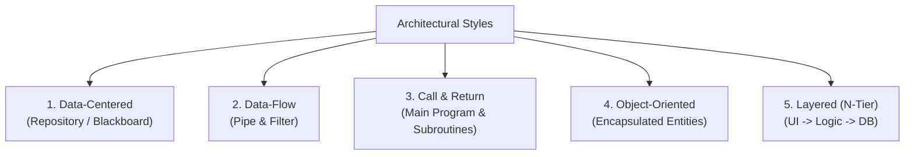
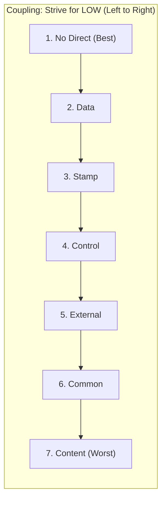
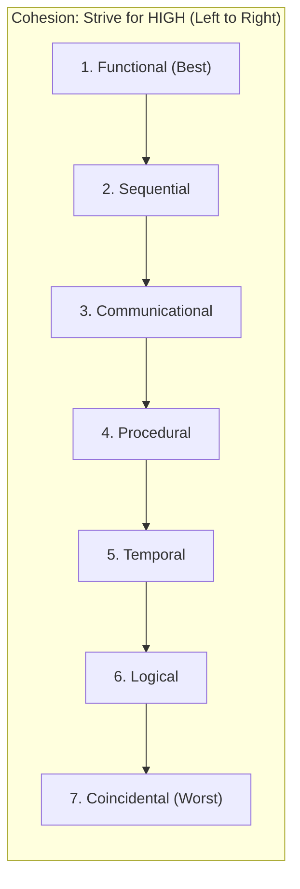

# 🏗️ Unit 4: Structured System Design

> **Source Traceability:** Extracted directly from Parul University syllabus slides `SE unit 4.pdf`, Pages 1–67. Cross-referenced with Pressman (Ch. 9–13) and Sommerville (Ch. 6–7).

---

## A. Topic Overview

### 1. What is this topic about?

Software Design is the engineering phase where customer requirements (from SRS) are translated into an actionable blueprint for software construction. This unit explores **Fundamental Design Concepts (Abstraction, Modularity, Information Hiding, Refactoring)**, **Architectural Styles & Patterns (Data-Centered, Pipe & Filter, Layered, Call & Return, Object-Oriented)**, the **Architecture Tradeoff Analysis Method (ATAM)**, **Peter Chen's ER Model**, **Logical vs Physical DFDs**, and the industry-critical concepts of **Coupling and Cohesion**.

### 2. Why does it matter?

Design is where software quality is fostered. A poorly designed codebase degenerates into an unmaintainable "Big Ball of Mud." High coupling and low cohesion lead to fragile code where fixing a bug in one module silently breaks three unrelated features.

---

## B. Explain Like I Am Learning It for the First Time

Think of designing a modern smartphone:

- It is not built as one solid piece of melted silicon and plastic.
- It is broken into distinct **Modules**: battery, camera module, display screen, speaker, and motherboard. That is **Modularity**.
- When replacing a broken battery, you don't need to rewire the camera sensor. The battery connects via a standardized plug. That is **Low Coupling**.
- Inside the camera module, all lenses, sensors, and image processors work exclusively toward one single task: capturing crisp photographs. That is **High Cohesion**.
- You don't need to know how the camera's image processing algorithm works to tap the shutter button on screen. That is **Abstraction** and **Information Hiding**.

---

## C. Detailed Exam Notes

### 1. Fundamental Software Design Concepts (Core Exam Checklist)

1. **Abstraction (Hide Irrelevant Data):** Permitting engineers to focus on high-level problem solving without getting bogged down in low-level bit manipulation.
   - _Procedural Abstraction:_ Named sequence of instructions with a specific function (e.g., `open_door()`).
   - _Data Abstraction:_ Named collection of data describing a data object (e.g., `Door` object with attributes `height`, `locked_state`).
2. **Modularity (Divide and Conquer):** Subdividing software into named, addressable components (modules) integrated to satisfy problem requirements.
   - _Meyer's Law of Modularity:_ Five criteria for modular design: Decomposability, Composability, Understandability, Continuity, and Protection.
3. **Software Architecture:** The overall structure of the software and the ways in which that structure provides conceptual integrity for a system.
4. **Stepwise Refinement (Top-Down):** A top-down design strategy originally proposed by Niklaus Wirth. High-level abstract statements are elaborated step by step into concrete procedural logic.
5. **Design Patterns:** A reusable, proven solution to a recurring design problem within a given context.
6. **Information Hiding (David Parnas Principle):** Modules should be designed so that internal algorithms and data structures are inaccessible to other modules that have no need to know them. Minimizes ripple effects when changes occur.
7. **Refactoring (Code Restructuring):** The process of changing a software system in such a way that it does not alter the external behavior of the code, yet improves its internal structure, readability, and performance.

---

### 2. Software Architectural Styles and Patterns



#### 1. Data-Centered Architecture (Repository / Blackboard)

- **Concept:** A central data store (database or blackboard) sits at the core. Multiple independent client software components access and modify the data repository.
- **Pros:** Highly scalable data sharing; independent client evolution.
- **Cons:** Central repository is a single point of failure and performance bottleneck.

#### 2. Data Flow Architecture (Pipe and Filter)

- **Concept:** The system is viewed as a series of transformations on consecutive streams of input data.
- **Components:**
  - _Pipes:_ Conduits that transport data streams from one component to another without modification.
  - _Filters:_ Independent transformation units that read incoming data streams, transform them, and emit processed output streams.
- **Examples:** UNIX shell pipelines (`cat file.txt | grep "error" | wc -l`), video rendering pipelines.
- **Pros:** Easy to understand, reusable filters, high concurrency.
- **Cons:** Interactive applications are difficult to model; overhead of parsing and unparsing data streams.

#### 3. Call and Return Architecture

- **Concept:** Traditional hierarchical program structure. Control starts at a main program and branches out into subroutines. Sub-styles include Remote Procedure Calls (RPC) in client-server systems.

#### 4. Object-Oriented Architecture

- **Concept:** Components encapsulate data and the operations that manipulate that data. Communication occurs through explicit message passing.
- **Pros:** Easy to maintain and reuse; maps directly to real-world domain concepts.
- **Cons:** Overhead of object instantiation; message passing can lead to latency.

#### 5. Layered Architecture (N-Tier Architecture)

- **Concept:** The system is organized hierarchically into layers. Each layer provides services to the layer immediately above it and consumes services from the layer immediately below it.
- **Standard 3-Tier Web Hierarchy:**
  - _Presentation Layer (UI)_
  - _Business Logic / Application Layer_
  - _Data Access Layer (Database)_
- **Pros:** Clear separation of concerns; changes in one layer do not ripple to distant layers.
- **Cons:** Performance penalties due to data traversing multiple intermediary layers.

---

### 3. Architecture Tradeoff Analysis Method (ATAM)

A formal 9-step scenario-based method developed by the Software Engineering Institute (SEI) to evaluate architectural decisions against quality goals (Performance, Availability, Security, Modifiability).

- **Core Steps:**
  1. _Present ATAM:_ Explain the evaluation methodology to stakeholders.
  2. _Present Business Drivers:_ Review business goals and architectural drivers.
  3. _Present Architecture:_ Lead architect explains design styles and patterns.
  4. _Identify Architectural Approaches:_ Catalog patterns used.
  5. _Generate Quality Attribute Utility Tree:_ Prioritize quality attributes (e.g., Performance vs Modifiability).
  6. _Analyze Architectural Approaches:_ Probe design against utility tree scenarios.
  7. _Brainstorm & Prioritize Scenarios:_ Stakeholders create real-world stress test scenarios.
  8. _Analyze Architectural Approaches:_ Map high-priority scenarios against architecture.
  9. _Present Results:_ Deliver final evaluation report identifying **Sensitivity Points, Tradeoff Points, and Risks**.

---

### 4. Coupling and Cohesion (The Most Important Topic in Unit 4!)

> [!IMPORTANT]
> **The Golden Rule of Software Design:** **MAXIMIZE Cohesion** (internal strength of a module) and **MINIMIZE Coupling** (interdependence between modules).



#### Detailed Types of Coupling (From Best to Worst)

1. **No Direct Coupling (Best):** Modules are completely independent; communicate neither directly nor indirectly.
2. **Data Coupling:** Modules communicate purely by passing simple, primitive scalar parameters (e.g., `calculate_tax(float income)`).
3. **Stamp Coupling (Data-Structure Coupling):** Modules share a composite data structure, but only need part of it (e.g., passing an entire `CustomerRecord` object when the function only needs `customer.zip_code`).
4. **Control Coupling:** One module passes a control flag or token that dictates the internal control flow and decision logic of the other module (e.g., `process_data(data, int flag)`).
5. **External Coupling:** Modules are tied to external communication protocols, device formats, or OS interfaces.
6. **Common Coupling:** Multiple modules read and write to the same **Global Data Area** or shared memory (e.g., global variables). High risk: one module corrupts global state, crashing all other modules.
7. **Content Coupling (Worst / Pathological):** One module directly modifies or accesses internal data or code of another module (e.g., branching into the middle of another subroutine, modifying private fields via reflection).

---



#### Detailed Types of Cohesion (From Best to Worst)

1. **Functional Cohesion (Best):** Every instruction inside the module performs exactly one, and only one, well-defined mathematical or logical function (e.g., `compute_square_root()`).
2. **Sequential Cohesion:** The output of one activity serves as the direct input to the next activity inside the same module (e.g., `read_file_and_parse_json()`).
3. **Communicational Cohesion:** All activities in the module operate on the exact same input data or produce the exact same output data (e.g., `update_and_print_customer_bill(customer_record)`).
4. **Procedural Cohesion:** Elements are grouped together because they follow a specific sequence of execution, even if they operate on different data (e.g., `check_file_permissions_then_open_network_socket()`).
5. **Temporal Cohesion:** Elements are grouped purely because they must execute within the same timeframe (e.g., `startup_initialization()` setting up databases, loading configs, displaying splash screen).
6. **Logical Cohesion:** Elements perform conceptually related functions (e.g., input/output processing), but a control parameter decides which one executes (e.g., `handle_all_inputs(int input_type)`).
7. **Coincidental Cohesion (Worst):** Elements have no meaningful relationship whatsoever; grouped purely by accident or in a "utilities" dumping ground (e.g., `MiscHelper` containing `calculate_tax()`, `play_sound()`, `reverse_string()`).

---

### 5. Data Flow Modeling: Logical vs Physical DFD

- **Logical DFD:** Focuses strictly on business processes and data flows without reference to physical technology, hardware, or implementation details (e.g., "Verify Order", "Store Customer Data").
- **Physical DFD:** Shows how the system is actually implemented in concrete reality (e.g., "Run Python validation script", "Write to PostgreSQL Customer Table on AWS RDS").

---

## D. Worked Examples

### Problem: Identifying Coupling & Cohesion in Code

**Analyze the following Python functions:**

```python
# Snippet A
def print_and_email_receipt(customer, order):
    formatted = f"Receipt for {customer.name}: Total ${order.total}"
    print(formatted)
    send_smtp_email(customer.email, formatted)

# Snippet B
def compute_circle_area(radius: float) -> float:
    import math
    return math.pi * (radius ** 2)
```

**Analysis & Solution:**

1. **Snippet A:**
   - _Cohesion:_ **Communicational Cohesion** (two distinct tasks—printing to console and sending an SMTP network email—are grouped together because they share the same input data). It violates Single Responsibility Principle.
   - _Coupling:_ **Stamp Coupling** (it accepts the entire `customer` and `order` objects just to access `name`, `email`, and `total`).
2. **Snippet B:**
   - _Cohesion:_ **Functional Cohesion (Highest)**. It does one specific mathematical calculation and returns the result.
   - _Coupling:_ **Data Coupling (Lowest/Best)**. It takes a single primitive scalar `float` value and returns a `float`.

---

## E. Code Implementation: Pipe and Filter Architectural Pattern

```python
"""
Pipe and Filter Architectural Pattern Implementation
Author: Exam Revision Tutor
Language: Python 3.10+
"""

from typing import List, Callable

class Pipeline:
    def __init__(self):
        self.filters: List[Callable[..., str]] = []

    def add_filter(self, filter_func: Callable[..., str]):
        self.filters.append(filter_func)
        return self

    def execute(self, data_stream: List[str]) -> List[str]:
        results = data_stream
        for f in self.filters:
            # Transform the stream through each pipe and filter
            results = [f(item) for item in results if item is not None]
        return results

# Define Reusable, Independent Filters
def filter_trim_whitespace(text: str) -> str:
    return text.strip()

def filter_remove_comments(text: str) -> str:
    return None if text.startswith("#") else text

def filter_to_uppercase(text: str) -> str:
    return text.upper()

if __name__ == "__main__":
    raw_source_code = [
        "   SELECT * FROM users;  ",
        "# This is a database comment",
        "WHERE active = 1;   ",
        "# End of SQL query",
        "ORDER BY id DESC;"
    ]

    sql_pipeline = Pipeline()
    sql_pipeline.add_filter(filter_trim_whitespace) \
                .add_filter(filter_remove_comments) \
                .add_filter(filter_to_uppercase)

    clean_stream = sql_pipeline.execute(raw_source_code)
    print("\n<mark>= PIPELINE EXECUTION OUTPUT </mark>=")
    for line in clean_stream:
        print(f"OUTPUT >> {line}")
```

---

## F. Memory and Understanding Techniques

### 1. Mnemonics for Cohesion & Coupling

- **Cohesion Levels (Best to Worst):** **"F-S-C-P-T-L-C"** -> **F**unctional, **S**equential, **C**ommunicational, **P**rocedural, **T**emporal, **L**ogical, **C**oincidental.
  _Memory Trick:_ **F**un **S**tudents **C**an **P**ass **T**he **L**ogic **C**ourse.
- **Coupling Levels (Best to Worst):** **"N-D-S-C-E-C-C"** -> **N**o direct, **D**ata, **S**tamp, **C**ontrol, **E**xternal, **C**ommon, **C**ontent.
  _Memory Trick:_ **N**o **D**og **S**hould **C**hase **E**very **C**at's **C**ar.

---

## G. Common Mistakes & Parul University Exam Tips

- **The Coupling Hierarchy Error:** Students often confuse Data Coupling and Stamp Coupling.
  _Rule:_ If you pass a simple integer or string, it is **Data Coupling**. If you pass an entire object, dictionary, or struct when only a field is needed, it is **Stamp Coupling**.
- **Cohesion Definition:** Do NOT define cohesion as "how modules communicate". That is coupling! Cohesion is the **intra-module strength** (how closely related elements are _inside_ one module).

---

## H. Quick Revision & Rapid Recall

### 5-Point Summary

1. Good software design exhibits **High Cohesion and Low Coupling**.
2. Abstraction hides internal implementation; Information Hiding limits accessibility of private data.
3. Pipe & Filter processes streams of data; Layered architecture enforces hierarchical separation of concerns.
4. ATAM is a formal 9-step scenario-based method for evaluating architectural trade-offs.
5. Functional Cohesion is the best cohesion; Content Coupling is the worst coupling.

### Rapid-Recall Flash Questions

1. _Q: What is the highest (best) form of cohesion?_  
   **A:** Functional Cohesion.
2. _Q: What is the worst (most dangerous) form of coupling?_  
   **A:** Content Coupling (pathological coupling).
3. _Q: Passing an entire `Employee` record to a function that only calculates salary is an example of what coupling?_  
   **A:** Stamp Coupling.
4. _Q: What architectural style is utilized in UNIX shell pipelines?_  
   **A:** Pipe and Filter architecture.
5. _Q: What does ATAM stand for?_  
   **A:** Architecture Tradeoff Analysis Method.

---

## 🧠 Interactive Practice Quiz

### Question 1 (MCQ)

Two software modules $M_1$ and $M_2$ both directly read and modify the same global configuration array stored in memory. What type of coupling exists between $M_1$ and $M_2$?

- A) Data Coupling
- B) Stamp Coupling
- C) Common Coupling
- D) Control Coupling

### Question 2 (Trap Question)

A module named `Utilities` contains three functions: `calculate_tax()`, `render_3d_cube()`, and `send_bluetooth_packet()`. What type of cohesion does this module exhibit?

- A) Logical Cohesion
- B) Coincidental Cohesion
- C) Procedural Cohesion
- D) Communicational Cohesion

---

<details>
<summary><b>💡 Click to Reveal Quiz Solutions & Trap Explanations</b></summary>

### 💡 Quiz Answers & Trap Explanations

1. **Answer: C (Common Coupling)**  
   _Explanation:_ When modules share access to global variables or global memory, they are common coupled.
2. **Answer: B (Coincidental Cohesion)**  
   _Explanation:_ The functions share no common data, no procedural sequence, and no conceptual similarity. Grouping them together is purely coincidental (the worst form of cohesion).

</details>
