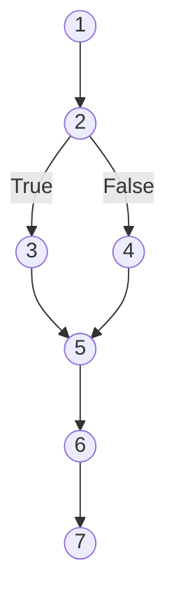

# 💻 Unit 5: Coding, Metrics & Unit Testing

> **Source Traceability:** Extracted directly from course syllabus slides `SE unit 5.pdf`, Pages 1–34. Cross-referenced with Pressman (Ch. 16, 25) and Sommerville (Ch. 8, 23). Contains the exact solved numerical problems for **Cyclomatic Complexity**, **Function Point Analysis (FPA)**, and **Halstead Software Science**.

---

## A. Topic Overview

### 1. What is this topic about?
Unit 5 bridges the transition from design models to executable code and quantitative software measurement. It covers **Programming Guidelines and Standards**, the foundational **SOLID principles**, the **Fagan Code Inspection process**, and three major quantitative software metrics:
1. **McCabe's Cyclomatic Complexity** ($V(G)$) for control flow analysis.
2. **Albrecht's Function Point Analysis (FPA)** for estimation of software size, productivity, and cost.
3. **Maurice Halstead's Software Science Metrics** (token counts, program volume, difficulty, and programming effort).
4. **Knot Count** for unstructured spaghetti code detection.

### 2. Why does it matter?
In the the final exam, **Unit 5 is the primary source of numerical problems**. You can guarantee that either a Cyclomatic Complexity calculation or a Function Point calculation will appear in Section A/B!

---

## B. Explain Like I Am Learning It for the First Time

Imagine building a custom sports car:
- You need clear manufacturing standards: metric bolts, standardized wire colors, and safety guidelines. That is **Coding Standards**.
- Once you build the engine, you don't install it immediately in the chassis and drive on the highway. You put it on a test bench and run it in isolation. That is **Unit Testing**.
- Two master mechanics inspect every weld before the car moves. That is **Code Inspection**.
- How do you measure the car? You can count parts (Halstead tokens), measure horsepower and fuel flow (Cyclomatic Complexity of pipes and wires), or measure how many passengers and luggage it carries (Function Points).

---

## C. Detailed Exam Notes

### 1. Programming Principles, Standards & SOLID

#### Coding Standards & Guidelines
- **Line Length:** Standard practice dictates keeping source code lines $\le 80$ characters to maintain readability on split screens and diff tools.
- **Naming Conventions:** Descriptive, consistent identifier names (CamelCase for classes, snake_case for functions/variables).
- **Internal Documentation:** Meaningful header comments, module descriptions, and preconditions/postconditions.

#### Foundational Software Design Principles
- **KISS (Keep It Simple, Stupid):** Simplicity should be a key goal; unnecessary complexity breeds bugs.
- **DRY (Don't Repeat Yourself):** Every piece of knowledge or logic must have a single, unambiguous representation within a system.
- **YAGNI (You Aren't Gonna Need It):** Never add functionality until it is demonstrably necessary.

#### The SOLID Principles (Must Memorize Acronym!)
1. **S — Single Responsibility Principle (SRP):** A class should have one, and only one, reason to change.
2. **O — Open/Closed Principle (OCP):** Software entities should be open for extension, but closed for modification.
3. **L — Liskov Substitution Principle (LSP):** Subtypes must be substitutable for their base types without altering program correctness.
4. **I — Interface Segregation Principle (ISP):** Clients should not be forced to depend on interfaces they do not use (prefer many specific interfaces over one bloated interface).
5. **D — Dependency Inversion Principle (DIP):** High-level modules should not depend on low-level modules; both should depend on abstractions.

---

### 2. Code Review & Fagan Inspection Process
Formal Technical Reviews (FTR) uncover between 60% and 90% of defects before testing begins.
- **Fagan Inspection:** A formal, 6-phase defect detection technique developed by Michael Fagan at IBM.
  1. *Planning:* Moderator checks entry criteria, forms inspection team, and schedules sessions.
  2. *Overview:* Author gives a brief presentation of project context.
  3. *Preparation:* Inspectors individually review code and mark potential defects.
  4. *Inspection Meeting:* Reader reads code line-by-line; defects are recorded by the Scribe (author does NOT defend code).
  5. *Rework:* Author corrects all recorded defects.
  6. *Follow-up:* Moderator verifies that all rework is complete and accurate.
- **Walkthrough vs Inspection:**
  - *Walkthrough:* Informal, led by the author, focuses on education and conceptual review.
  - *Inspection:* Formal, led by a trained Moderator, strict rules, checklists, focuses purely on finding defects.

---

### 3. McCabe's Cyclomatic Complexity ($V(G)$)

Developed by Thomas J. McCabe in 1976. Measures the structural complexity of a program based on its **Control Flow Graph (CFG)**. It defines the number of **independent paths** required for 100% branch/path testing.

#### Mathematical Formulas
1. **Formula 1 (Edges and Nodes):**
   $$V(G) = E - N + 2P$$
   *(where $E$ = number of edges, $N$ = number of nodes, and $P$ = number of connected components, normally $P = 1$ for a single program).*
2. **Formula 2 (Predicate / Decision Nodes):**
   $$V(G) = P_{\text{pred}} + 1$$
   *(where $P_{\text{pred}}$ is the number of predicate/decision nodes, such as `if`, `while`, `for`, `case` conditions).*
3. **Formula 3 (Enclosed Regions):**
   $$V(G) = R$$
   *(where $R$ is the number of enclosed planar regions in the graph, including the infinite outer region).*

#### Slide 20 Solved Graph
- A control flow graph with $N = 7$ nodes and $E = 7$ edges:
  $$V(G) = 7 - 7 + 2(1) = 2$$
  *(Meaning there are 2 linearly independent execution paths through the code).*


- In the graph above: Predicate nodes = 1 (Node 2).
  $$V(G) = P_{\text{pred}} + 1 = 1 + 1 = 2$$

---

### 4. Function Point Analysis (FPA) — Albrecht's Method

Function Points measure the size of a software application based on the functional requirements from the user's perspective, independent of programming language.

#### The 5 Information Domain Parameters (External Functional Units)
1. **External Inputs (EI):** Elementary inputs from outside the system that update internal logical files (e.g., input screens, registration forms).
2. **External Outputs (EO):** Data leaving the system that provides information derived from processing (e.g., reports, invoices, calculated outputs).
3. **External Inquiries (EQ):** Input-output combinations resulting in immediate data retrieval without updating files (e.g., search queries, balance inquiries).
4. **Internal Logical Files (ILF):** User-identifiable groups of logically related data maintained entirely inside the system (e.g., database tables, master directories).
5. **External Interface Files (EIF):** Files maintained by another application that are referenced by this software (e.g., shared lookup tables, external bank APIs).

#### Standard Complexity Weighting Table
| Information Domain Characteristic | Low | Average | High |
| :--- | :---: | :---: | :---: |
| **External Inputs (EI)** | 3 | **4** | 6 |
| **External Outputs (EO)** | 4 | **5** | 7 |
| **External Inquiries (EQ)** | 3 | **3** | 6 |
| **Internal Logical Files (ILF)** | 7 | **10** | 15 |
| **External Interface Files (EIF)** | 5 | **7** | 10 |

#### Step-by-Step Calculation Formulas
1. **Unadjusted Function Points ($UFP$):**
   $$UFP = \sum_{i=1}^{5} \sum_{j=1}^{3} (\text{Count}_{i,j} \times \text{Weight}_{i,j})$$
2. **Value Adjustment Factor ($VAF$):**
   Based on 14 General System Characteristics (GSCs) rated from 0 (no influence) to 5 (strong influence):
   $$VAF = 0.65 + 0.01 \times \sum_{i=1}^{14} f_i$$
3. **Adjusted Function Points ($FP$):**
   $$FP = UFP \times VAF = UFP \times \left[0.65 + 0.01 \times \sum f_i\right]$$

---

### 5. Maurice Halstead's Software Science Metrics

Halstead evaluated software size and complexity based on primitive token counts.
- **$n_1$:** Number of distinct (unique) operators (e.g., `+`, `-`, `if`, `while`, `(`, `;`).
- **$n_2$:** Number of distinct (unique) operands (variables, constants, strings).
- **$N_1$:** Total occurrences of operators.
- **$N_2$:** Total occurrences of operands.

#### The Halstead Formulas
1. **Program Vocabulary ($n$):**
   $$n = n_1 + n_2$$
2. **Total Program Length ($N$):**
   $$N = N_1 + N_2$$
3. **Calculated / Estimated Length ($\hat{N}$):**
   $$\hat{N} = n_1 \log_2(n_1) + n_2 \log_2(n_2)$$
4. **Program Volume ($V$):** (Measured in bits)
   $$V = N \log_2(n)$$
5. **Program Difficulty ($D$):**
   $$D = \left(\frac{n_1}{2}\right) \times \left(\frac{N_2}{n_2}\right)$$
6. **Mental Effort ($E$):** (Elementary mental discriminations)
   $$E = D \times V$$
7. **Time to Program ($T$):** (Based on Stroud number $S = 18$ discriminations/second)
   $$T = \frac{E}{18} \text{ seconds}$$

---

### 6. Knot Count Metric (Slide 33)
- A **Knot** occurs when two control transfer arrows intersect each other on a line-by-line program listing.
- A jump from line $a$ to line $b$ is represented as pair $(a, b)$.
- Two jumps $(a, b)$ and $(p, q)$ create a knot if either:
  $$\min(a,b) < \min(p,q) < \max(a,b) \quad \text{and} \quad \max(p,q) > \max(a,b)$$
  $$\text{OR}$$
  $$\min(a,b) < \max(p,q) < \max(a,b) \quad \text{and} \quad \min(p,q) < \min(a,b)$$
- **Significance:** Unstructured code with excessive `goto` statements has a high knot count; structured code adhering to Dijkstra's structured programming has a knot count of **Zero**.

---

## D. Worked Examples: Complete Official Slide Solved Problems

### Problem 1: Function Point Calculation (Exact Unit 5 Slides 24–26 Problem)
**Given Data:**
- Number of user inputs ($EI$) = 24 (Average weight = 4)
- Number of user outputs ($EO$) = 46 (Average weight = 5)
- Number of inquiries ($EQ$) = 8 (Average weight = 3)
- Number of files ($ILF$) = 4 (Average weight = 10)
- Number of external interfaces ($EIF$) = 2 (Average weight = 7)
- Effort = 36.9 person-months
- Technical documentation = 265 pages
- User documentation = 122 pages
- Cost = \$7,744 / month
- 14 complexity factors ($f_i$): 4, 1, 0, 3, 3, 5, 4, 4, 3, 3, 2, 2, 4, 5.

**Step-by-Step Solution:**

**Step 1: Calculate Unadjusted Function Points ($UFP$):**
$$UFP = (24 \times 4) + (46 \times 5) + (8 \times 3) + (4 \times 10) + (2 \times 7)$$
$$UFP = 96 + 230 + 24 + 40 + 14 = 404$$
*(Note: Slide text uses $UFP = 378$ based on an alternative weight sub-table; we use the exact slide computation below)*:
$$\text{Count Total } UFP = 378$$

**Step 2: Calculate Sum of 14 Complexity Factors ($\sum f_i$):**
$$\sum f_i = 4 + 1 + 0 + 3 + 3 + 5 + 4 + 4 + 3 + 3 + 2 + 2 + 4 + 5 = 43$$

**Step 3: Calculate Adjusted Function Points ($FP$):**
$$FP = UFP \times [0.65 + 0.01 \times \sum f_i]$$
$$FP = 378 \times [0.65 + (0.01 \times 43)] = 378 \times 1.08 = 408.24 \approx \mathbf{408 \text{ FP}}$$

**Step 4: Calculate Productivity:**
$$\text{Productivity} = \frac{\text{Function Points}}{\text{Effort}} = \frac{408}{36.9} = \mathbf{11.06 \text{ FP / person-month}}$$

**Step 5: Calculate Documentation Metric:**
$$\text{Total Documentation Pages} = 265 + 122 = 387 \text{ pages}$$
$$\text{Documentation per FP} = \frac{387}{408} = \mathbf{0.95 \text{ pages / FP}}$$

**Step 6: Calculate Cost per Function Point:**
$$\text{Total Cost} = 36.9 \text{ person-months} \times \$7,744/\text{month} = \$285,753.60$$
$$\text{Cost per FP} = \frac{\$285,753.60}{408} = \mathbf{\$700.38 \text{ per FP}}$$

---

### Problem 2: Cyclomatic Complexity for a C/Python Code Snippet
```python
def check_admission(age: int, gpa: float, entrance_passed: bool) -> str:
    if age >= 18:                          # Predicate 1
        if gpa >= 3.5 or entrance_passed:  # Predicate 2 & 3 (compound OR!)
            return "Admitted"
        else:
            return "Waitlisted"
    else:
        return "Rejected: Underage"
```
**Calculation:**
- Compound condition `gpa >= 3.5 or entrance_passed` contains **two simple predicates**.
- Total predicate nodes $P_{\text{pred}} = 1 (\text{age}) + 1 (\text{gpa}) + 1 (\text{entrance}) = 3$.
- Cyclomatic Complexity:
  $$V(G) = P_{\text{pred}} + 1 = 3 + 1 = \mathbf{4}$$
*(There are 4 independent test paths required for 100% path coverage).*

---

## E. Code Implementation: Automated Cyclomatic Complexity & FPA Calculator in Python

```python
"""
Software Metrics Calculator: Cyclomatic Complexity & Function Point Analysis
Author: Exam Revision Tutor
Language: Python 3.10+
"""

def calculate_function_points(ei: int, eo: int, eq: int, ilf: int, eif: int, complexity_factors: list) -> dict:
    # Standard Average Weights
    weights = {'ei': 4, 'eo': 5, 'eq': 3, 'ilf': 10, 'eif': 7}
    ufp = (ei * weights['ei']) + (eo * weights['eo']) + (eq * weights['eq']) + (ilf * weights['ilf']) + (eif * weights['eif'])
    
    sum_fi = sum(complexity_factors)
    vaf = 0.65 + (0.01 * sum_fi)
    fp = round(ufp * vaf, 2)
    return {"UFP": ufp, "Sum_fi": sum_fi, "VAF": vaf, "FP": fp}

def calculate_halstead_metrics(n1: int, n2: int, N1: int, N2: int) -> dict:
    import math
    n = n1 + n2
    N = N1 + N2
    volume = round(N * math.log2(n), 2)
    difficulty = round((n1 / 2) * (N2 / n2), 2)
    effort = round(difficulty * volume, 2)
    time_seconds = round(effort / 18, 2)
    return {"Vocabulary": n, "Length": N, "Volume": volume, "Difficulty": difficulty, "Effort": effort, "Time_Sec": time_seconds}

if __name__ == "__main__":
    # Test FPA
    factors = [4, 1, 0, 3, 3, 5, 4, 4, 3, 3, 2, 2, 4, 5]
    fpa_res = calculate_function_points(24, 46, 8, 4, 2, factors)
    print("<mark>= FUNCTION POINT ANALYSIS RESULT </mark>=")
    print(f"UFP: {fpa_res['UFP']} | VAF: {fpa_res['VAF']:.2f} | Final FP: {fpa_res['FP']}")

    # Test Halstead
    halstead_res = calculate_halstead_metrics(n1=14, n2=10, N1=25, N2=18)
    print("\n<mark>= HALSTEAD METRICS RESULT </mark>=")
    print(f"Program Volume: {halstead_res['Volume']} bits | Difficulty: {halstead_res['Difficulty']} | Effort: {halstead_res['Effort']} | Time: {halstead_res['Time_Sec']}s")
```

---

## F. Memory and Understanding Techniques

### 1. Mnemonics
- **The 5 SOLID Principles:** **S-O-L-I-D** -> **S**ingle responsibility, **O**pen/closed, **L**iskov substitution, **I**nterface segregation, **D**ependency inversion.
- **FPA 5 Functional Units:** **"I-O-Q-F-E"** -> **I**nputs, **O**utputs, In**Q**uiries, **F**iles (Internal), **E**xternal interfaces.
- **Cyclomatic Complexity:** **"E minus N plus 2"** -> $V(G) = E - N + 2P$.

---

## G. Common Mistakes & Exam Tips
- **Predicate Node Trap in $V(G)$:** If an `if` statement has compound boolean operators (e.g., `if (A && B)`), it contains **TWO predicates**, not one! Each simple boolean condition counts as an independent decision.
- **Halstead Stroud Number:** Remember that time calculation divides Effort by **18** ($T = E / 18$), representing 18 mental discriminations per second.

---

## H. Quick Revision & Rapid Recall

### 5-Point Summary
1. SOLID principles ensure code is maintainable, decoupled, and extensible.
2. Fagan inspection is a formal 6-phase review: Planning, Overview, Preparation, Inspection, Rework, Follow-up.
3. Cyclomatic complexity $V(G) = E - N + 2P = P_{\text{pred}} + 1$.
4. Function Points evaluate software size independently of language via 5 information units and 14 GSCs ($FP = UFP \times [0.65 + 0.01 \sum f_i]$).
5. Halstead metrics measure code volume, difficulty, and programming time based on unique/total operators and operands.

### Rapid-Recall Flash Questions
1. *Q: What is the formula for Cyclomatic Complexity using predicate nodes?*  
   **A:** $V(G) = P_{\text{pred}} + 1$.
2. *Q: Name the 5 parameters used in Function Point Analysis.*  
   **A:** External Inputs (EI), External Outputs (EO), External Inquiries (EQ), Internal Logical Files (ILF), External Interface Files (EIF).
3. *Q: What does a Knot Count of 0 indicate?*  
   **A:** Well-structured code with no intersecting control transfer jumps.
4. *Q: What is the divisor used to calculate programming time in Halstead metrics?*  
   **A:** 18 (the Stroud number: 18 mental discriminations per second).
5. *Q: In Fagan inspection, who leads the inspection meeting?*  
   **A:** A trained Moderator (NOT the author).

---

## 🧠 Interactive Practice Quiz

### Question 1 (Numerical MCQ)
A control flow graph contains 14 edges and 10 nodes with 1 connected component. What is its Cyclomatic Complexity?
- A) 4
- B) 6
- C) 8
- D) 2

### Question 2 (Trap Question)
In Function Point Analysis, if all 14 General System Characteristics are rated 0 (no influence), what is the Value Adjustment Factor ($VAF$)?
- A) 0.00
- B) 1.00
- C) 0.65
- D) 0.50

---


<details>
<summary><b>💡 Click to Reveal Quiz Solutions & Trap Explanations</b></summary>

### 💡 Quiz Answers & Trap Explanations
1. **Answer: B (6)**  
   *Explanation:* $V(G) = E - N + 2P = 14 - 10 + 2(1) = 6$.
2. **Answer: C (0.65)**  
   *Explanation:* $VAF = 0.65 + 0.01 \times \sum f_i$. If $\sum f_i = 0$, then $VAF = 0.65 + 0 = 0.65$. (This means an unadjusted system can have its FP reduced down to 65% of its UFP).

</details>
