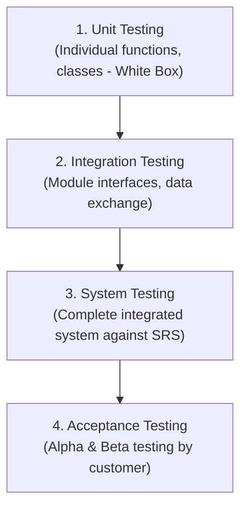
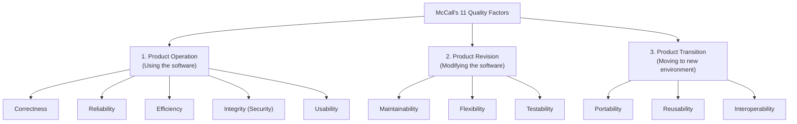

# 🧪 Unit 6: Software Testing & Quality Assurance

> **Source Traceability:** Extracted directly from course syllabus slides `SE unit 6.pdf`, Pages 1–53. Cross-referenced with Pressman (Ch. 17–20) and Sommerville (Ch. 8, 24). Contains the exact BVA $[18, 30]$ test suite and McCall's 11 Factors.

---

## A. Topic Overview

### 1. What is this topic about?
Software Testing is the systematic execution of software under controlled conditions to uncover defects and ensure fitness for purpose. This unit examines the **Psychology of Testing**, **Levels of Testing (Unit, Integration, System, Acceptance)**, the **IEEE 829 Test Plan standard**, **Black-Box testing techniques (Boundary Value Analysis, Equivalence Partitioning, Pairwise Testing, State-Based Testing)**, **White-Box testing**, **Software Quality Assurance (SQA)**, **McCall's 11 Quality Factors**, and **ISO 9000/9001 Certification**.

### 2. Why does it matter?
Testing is the primary defense against software failure. In the exams, **Boundary Value Analysis (BVA)** and **McCall's Quality Factors** appear consistently as 4-mark and 5-mark questions!

---

## B. Explain Like I Am Learning It for the First Time

Think of crash-testing a new family automobile:
- The manufacturer doesn't just ask the engineer who designed the car: *"Did you build it well?"*
- They bring in independent safety testers who actively try to break it: crash it into concrete barriers at 60 mph, freeze it in arctic chambers, and slam the brakes on ice. That is the **Psychology of Testing**: it is destructive, objective, and relentless.
- Testing the brakes alone is **Unit Testing**.
- Testing the engine connected to the transmission is **Integration Testing**.
- Testing the entire assembled car on a test track is **System Testing**.
- Having real drivers test-drive it on city streets is **Acceptance Testing (Beta Testing)**.

---

## C. Detailed Exam Notes

### 1. Quality & The Psychology of Testing
- **Definition of Quality:** Quality is defined as "fitness for use and purpose" (Joseph Juran) and meeting or exceeding customer requirements in terms of functionality, reliability, durability, and performance.
- **The Psychology of Testing (Glenford Myers):**
  - Testing is the process of executing a program with the **intent of finding errors** (not proving that it has no errors!).
  - A *successful* test is one that uncovers a previously undiscovered bug.
  - Developers should never test their own code for system/acceptance testing because of psychological bias (subconsciously avoiding inputs that break their own creation).

---

### 2. Levels of Software Testing (The Testing Hierarchy)



1. **Unit Testing:** Tests individual software units or components in isolation. Relies primarily on White-Box testing.
2. **Integration Testing:** Tests interactions and communication interfaces between integrated modules:
   - *Big Bang Integration:* All modules combined at once and tested. (Disastrous; defects are impossible to isolate).
   - *Top-Down Integration:* Starts with the main control module. Subordinate modules are replaced by **Stubs** (temporary dummy modules that simulate called routines).
   - *Bottom-Up Integration:* Starts with low-level worker modules. Superordinate modules are replaced by **Drivers** (temporary test harnesses that call the modules with test parameters).
   - *Regression Testing:* Re-running previous test suites after code changes to ensure existing functionality remains uncorrupted.
   - *Smoke Testing:* Daily build verification testing to ensure the build is stable enough for deeper testing.
3. **System Testing:** Validates the fully integrated system against requirements: Performance testing, Stress testing, Security testing, Recovery testing.
4. **Acceptance Testing:**
   - *Alpha Testing:* Conducted at the developer's site by end users in a controlled environment.
   - *Beta Testing:* Conducted at user sites in real-world uncontrolled environments without developers present.

---

### 3. Test Plan Structure (IEEE 829 Standard)
The test plan is the master governance document outlining testing activities.
**8 Steps to Create a Test Plan as per IEEE 829 (Slide 15):**
1. *Analyze the Product:* Understand architecture, customer requirements, and constraints.
2. *Design Test Strategy:* Define testing levels and methodologies.
3. *Define Project Scope:* Explicitly state what features are *in-scope* and *out-of-scope*.
4. *Create Test Logistics:* Define who will test and establish roles.
5. *Define Test Objectives & Criteria:* Entry criteria, Suspension criteria, and Exit criteria.
6. *Resource Planning:* Hardware, software licenses, testing staff.
7. *Plan Test Environment:* Servers, database test data, network configs.
8. *Schedule & Estimation:* Deadlines, milestones, and deliverable handoffs.

---

### 4. Black-Box Testing Techniques (Exam Heavyweight!)

#### A. Boundary Value Analysis (BVA)
Errors cluster disproportionately at input boundaries rather than in the center of input domains.
- For an input domain bounded by $[Min, Max]$, BVA selects 7 test values:
  $$\{Min - 1, \; Min, \; Min + 1, \; \text{Nominal (Typical)}, \; Max - 1, \; Max, \; Max + 1\}$$

#### Official Slide 31 Solved Problem: Age Range $[18, 30]$
- Input: Age between 18 and 30 inclusive.
- Minimum = 18, Maximum = 30.
- **The Complete BVA Test Suite:**
  1. $Min - 1 = 17$ (Invalid - Should trigger error)
  2. $Min = 18$ (Valid Boundary)
  3. $Min + 1 = 19$ (Valid Interior)
  4. $Nominal = 24$ (Valid Nominal Center)
  5. $Max - 1 = 29$ (Valid Interior)
  6. $Max = 30$ (Valid Boundary)
  7. $Max + 1 = 31$ (Invalid - Should trigger error)

```
        Invalid          Valid Range [18, 30]           Invalid
    <-------------|<mark></mark><mark></mark><mark></mark><mark></mark><mark></mark><mark></mark><mark></mark><mark></mark>|------------->
                 17   18   19          24         29   30   31
               (Min-1)(Min)(Min+1)   (Nominal)  (Max-1)(Max)(Max+1)
```

#### B. Equivalence Class Partitioning (ECP)
Divides the input domain into classes of data from which test cases can be derived:
- *Valid Equivalence Class:* Represents valid inputs to the program.
- *Invalid Equivalence Class:* Represents erroneous inputs that must be rejected.
- *Rule:* One test case covers multiple valid classes; separate test cases must be used for each invalid class.

#### C. Pairwise Testing (All-Pairs Combinatorial Testing - Slide 32–35)
- **Concept:** Most software defects are triggered by either a single input parameter or an interaction between two parameters (pairwise interactions).
- **Slide 33–35 Example:**
  - An application has a list box with 10 elements ($0-9$), a checkbox (Checked/Unchecked: 2 states), and radio buttons (Option A/B/C: 3 states).
  - *Exhaustive testing:* Generates $> 4,000$ combinations!
  - *Pairwise testing:* Utilizes **Orthogonal Arrays** to test all pairs of input combinations, reducing test cases by **over 90%** while retaining high defect detection capability.

#### D. State-Based Testing (State Transition Testing)
Tests software where output depends not only on current input, but on **prior system state**. Modeled using State Transition Diagrams and State Tables (States, Events, Guards, Actions).

---

### 5. McCall's Software Quality Factor Model (100% Guaranteed Question!)

Developed by Jim McCall in 1977. Organizes 11 software quality factors into **3 Perspectives**:



| Category | Quality Factors | Description & Exam Keywords |
| :--- | :--- | :--- |
| **1. Product Operation** | **Correctness** | Extent to which program satisfies its specification and fulfills customer mission. |
| | **Reliability** | Extent to which program performs without failure under specified conditions. |
| | **Efficiency** | Amount of computing resources and code required to perform a function. |
| | **Integrity** | Extent to which unauthorized access to software or data can be controlled (Security). |
| | **Usability** | Effort required to learn, operate, prepare input, and interpret output. |
| **2. Product Revision** | **Maintainability** | Effort required to locate and fix an error in an operational program. |
| | **Flexibility** | Effort required to modify an operational program to adapt to new needs. |
| | **Testability** | Effort required to test a program to ensure that it performs its intended function. |
| **3. Product Transition**| **Portability** | Effort required to transfer the program from one hardware/OS environment to another. |
| | **Reusability** | Extent to which a program or module can be reused in other applications. |
| | **Interoperability** | Effort required to couple one system with another system. |

---

### 6. Quality Management & ISO 9000 / 9001 Standards
- **Quality Assurance (QA) vs Quality Control (QC):**
  - *QA (Process-Oriented / Prevention):* Proactive activities ensuring the development process is capable of producing defect-free products (Audits, Training, Standards).
  - *QC (Product-Oriented / Detection):* Reactive activities focused on identifying defects in the actual product (Testing, Code Reviews).
- **ISO 9000 & 9001:**
  - ISO 9000 defines quality vocabulary and principles.
  - ISO 9001 defines the requirements for a Quality Management System (QMS).
- **The 7 Steps for ISO 9000 Certification (Slide 51):**
  1. *Application:* Organization applies to an accredited registrar.
  2. *Pre-Assessment:* Registrar reviews quality manual and documentation.
  3. *Stage 1 Audit (Document Review):* Verifies compliance of written procedures.
  4. *Stage 2 Audit (On-Site Certification Audit):* Auditors interview staff and verify that daily work follows documented processes.
  5. *Corrective Action:* Company addresses any non-conformances identified.
  6. *Certification Award:* Registrar issues official ISO certificate.
  7. *Surveillance Audits:* Periodic follow-up audits to maintain certification.

---

## D. Worked Examples: Complete Test Case Specification (IEEE 829 Format)

**Test Case ID:** `TC-AUTH-BVA-01`  
**Test Suite:** User Registration Validation  
**Feature Under Test:** Age input field $[18, 30]$  
**Preconditions:** Registration page is open and user is logged out.  

| Test Case ID | Test Input (Age) | Purpose / Class | Expected Result | Pass / Fail Criteria |
| :---: | :---: | :---: | :---: | :---: |
| `TC-01` | 17 | Boundary: $Min - 1$ | Error: "Age must be at least 18" | Pass if blocked with error |
| `TC-02` | 18 | Boundary: $Min$ | Accepted; progress to next screen | Pass if registered |
| `TC-03` | 19 | Boundary: $Min + 1$ | Accepted; progress to next screen | Pass if registered |
| `TC-04` | 24 | Nominal Center | Accepted; progress to next screen | Pass if registered |
| `TC-05` | 29 | Boundary: $Max - 1$ | Accepted; progress to next screen | Pass if registered |
| `TC-06` | 30 | Boundary: $Max$ | Accepted; progress to next screen | Pass if registered |
| `TC-07` | 31 | Boundary: $Max + 1$ | Error: "Age must be 30 or below" | Pass if blocked with error |

---

## E. Code Implementation: Automated BVA Test Harness in Python

```python
"""
Automated Boundary Value Analysis (BVA) Test Harness
Author: Exam Revision Tutor
Language: Python 3.10+
"""

from typing import Tuple

def validate_age_eligibility(age: int) -> Tuple[bool, str]:
    """Validates eligibility for youth scholarship (Ages 18 to 30 inclusive)"""
    if not isinstance(age, int):
        return False, "Error: Age must be an integer"
    if age < 18:
        return False, "Rejected: Applicant is below minimum age (18)"
    elif age > 30:
        return False, "Rejected: Applicant exceeds maximum age (30)"
    else:
        return True, "Accepted: Age within eligible boundary"

def run_bva_suite():
    test_cases = [
        ("TC-01 (Min - 1)", 17, False),
        ("TC-02 (Min)",     18, True),
        ("TC-03 (Min + 1)", 19, True),
        ("TC-04 (Nominal)", 24, True),
        ("TC-05 (Max - 1)", 29, True),
        ("TC-06 (Max)",     30, True),
        ("TC-07 (Max + 1)", 31, False)
    ]

    print("\n<mark>= EXECUTING BOUNDARY VALUE ANALYSIS SUITE </mark>=")
    passed = 0
    for name, input_val, expected_valid in test_cases:
        is_valid, msg = validate_age_eligibility(input_val)
        status = "PASS" if is_valid == expected_valid else "FAIL"
        if status == "PASS":
            passed += 1
        print(f"[{status}] {name:<16} | Input: {input_val:<3} | Expected: {str(expected_valid):<5} | Actual: {str(is_valid):<5} | Msg: {msg}")
    
    print("-" * 75)
    print(f"RESULTS: {passed}/{len(test_cases)} Test Cases Passed ({passed/len(test_cases)*100:.1f}%)")

if __name__ == "__main__":
    run_bva_suite()
```

---

## F. Memory and Understanding Techniques

### 1. Mnemonics for McCall's 11 Factors
- **The 3 Categories:** **"O-R-T"** -> Product **O**peration, Product **R**evision, Product **T**ransition.
- **Product Operation (5 Factors):** **"C-R-E-I-U"** -> **C**orrectness, **R**eliability, **E**fficiency, **I**ntegrity, **U**sability.
  *Memory Trick:* **C**lever **R**esearchers **E**njoy **I**ntelligent **U**sers.
- **Product Revision (3 Factors):** **"M-F-T"** -> **M**aintainability, **F**lexibility, **T**estability.
- **Product Transition (3 Factors):** **"P-R-I"** -> **P**ortability, **R**eusability, **I**nteroperability.

---

## G. Common Mistakes & Exam Tips
- **Stub vs Driver Trap (2-Mark Question):**
  - **Stub:** A dummy module called by the module under test; used in **Top-Down Integration**.
  - **Driver:** A test harness that calls the module under test; used in **Bottom-Up Integration**.
- **Alpha vs Beta Testing Distinction:**
  - Alpha is at the *developer's site* with developers present.
  - Beta is at the *user's site* in the wild without developers present.

---

## H. Quick Revision & Rapid Recall

### 5-Point Summary
1. The 4 levels of testing are Unit, Integration, System, and Acceptance.
2. Top-down integration uses Stubs; bottom-up integration uses Drivers.
3. BVA selects 7 points: $Min-1, Min, Min+1, Nominal, Max-1, Max, Max+1$.
4. McCall's model classifies 11 factors into Product Operation, Revision, and Transition.
5. ISO 9001 certifies an organization's Quality Management System (QMS), not a specific piece of software.

### Rapid-Recall Flash Questions
1. *Q: What are the 3 categories in McCall's Factor Model?*  
   **A:** Product Operation, Product Revision, and Product Transition.
2. *Q: For input range $[18, 30]$, what are the invalid BVA test cases?*  
   **A:** 17 ($Min - 1$) and 31 ($Max + 1$).
3. *Q: What is the primary purpose of Regression Testing?*  
   **A:** To ensure that recent code modifications have not introduced new defects into previously working features.
4. *Q: Distinguish between Quality Assurance and Quality Control.*  
   **A:** QA is process-oriented prevention; QC is product-oriented defect detection.
5. *Q: What standard governs software test documentation?*  
   **A:** IEEE 829 Standard.

---

## 🧠 Interactive Practice Quiz

### Question 1 (MCQ)
Which McCall quality factor evaluates the effort required to transfer software from a Windows operating system to a Linux platform?
- A) Interoperability
- B) Portability
- C) Reusability
- D) Flexibility

### Question 2 (Trap Question)
In integration testing, a developer replaces a missing sub-function with a simple dummy script that prints "Calculation OK" and returns 0. This dummy script is known as a:
- A) Test Driver
- B) Test Stub
- C) Test Oracle
- D) Test Mock

---


<details>
<summary><b>💡 Click to Reveal Quiz Solutions & Trap Explanations</b></summary>

### 💡 Quiz Answers & Trap Explanations
1. **Answer: B (Portability)**  
   *Explanation:* Portability measures the ease of transferring software from one environment/platform to another. Interoperability is coupling with other systems.
2. **Answer: B (Test Stub)**  
   *Explanation:* Stubs simulate called lower-level modules (used in Top-Down testing). Drivers simulate calling higher-level modules (used in Bottom-Up testing).

</details>
