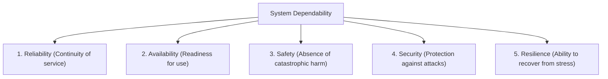

# 🛠️ Unit 7: CASE Tools & System Dependability

> **Source Traceability:** Extracted directly from Parul University syllabus slides `SE unit 7.pdf`, Pages 1–11. Cross-referenced with Pressman (Ch. 3, 14) and Sommerville (Ch. 10–14).

---

## A. Topic Overview

### 1. What is this topic about?
This unit explores automated engineering environments through **Computer-Aided Software Engineering (CASE) Tools**, their architecture, central repository mechanisms, and integration with **Scrum**. It then transitions into **System Dependability**, covering **Software Reliability Engineering (SRE)** metrics ($MTTF, MTTR, MTBF, \text{Availability}$), **Safety Engineering** (hazard analysis in safety-critical systems), **Security Engineering** (the CIA triad), and **Resilience Engineering**.

### 2. Why does it matter?
Modern enterprise software must be dependable. A crash in an e-commerce checkout causes lost revenue; a crash in an aircraft flight control system causes fatalities. Dependability engineering ensures software operates safely and reliably under stress.

---

## B. Explain Like I Am Learning It for the First Time

Imagine a modern automated aircraft factory:
- Workers don't hammer metal by hand or sketch blueprints on napkins. They use computerized CAD/CAM robots that design, fabricate, and test components automatically. In software, those automated development platforms are **CASE Tools**.
- When designing the passenger airplane, it's not enough for the plane to be fast and fuel-efficient.
- If an engine fails at 35,000 feet, what happens? (That is **Safety Engineering**).
- Can hackers intercept navigation signals? (That is **Security Engineering**).
- If the main electrical bus shuts down, can backup batteries keep cockpit screens alive? (That is **Resilience Engineering**).

---

## C. Detailed Exam Notes

### 1. Computer-Aided Software Engineering (CASE) Tools
- **Definition:** CASE tools are software applications that provide automated or semi-automated support for software development and maintenance activities throughout the SDLC.
- **The Central Repository (Heart of CASE):**
  - Serves as the single source of truth for all project assets.
  - *Stores:* Requirement documents, UML diagrams, data dictionaries, source code, test cases, bug tracking databases, and project management schedules.
  - *Functions:* Enforces data consistency, enables traceability, prevents merge conflicts, and supports audit trails.

#### Classification of CASE Tools
1. **Upper CASE Tools (Front-End):** Support early phases of the SDLC (Planning, Requirements Gathering, Analysis, and Architectural Design). Examples: StarUML, Enterprise Architect.
2. **Lower CASE Tools (Back-End):** Support late phases of the SDLC (Detailed Design, Code Generation, Compilation, Testing, and Defect Tracking). Examples: JIRA, JUnit, SonarQube.
3. **Integrated CASE Tools (I-CASE):** Span the entire software development lifecycle, linking upper and lower tools through a shared central repository.

```
+-------------------------------------------------------+
|                 UPPER CASE TOOLS                      |
|       (Planning, Requirements, Analysis & Design)     |
+---------------------------+---------------------------+
                            |
                            v
+-------------------------------------------------------+
|                  CENTRAL REPOSITORY                   |
|   (Data Dictionary, Diagrams, Schemas, Traceability)  |
+---------------------------+---------------------------+
                            |
                            v
+-------------------------------------------------------+
|                 LOWER CASE TOOLS                      |
|     (Code Generation, Compilers, Testing, Debugging)  |
+-------------------------------------------------------+
```

#### Integrating CASE Tools with Scrum (Slide 5)
- *Sprint Planning:* Visualizing user stories, estimating story points, and allocating sprint capacity.
- *Backlog Management:* Dynamic prioritization and drag-and-drop story assignment.
- *Burndown Tracking:* Automated generation of sprint burndown and velocity charts.

---

### 2. System Dependability & Reliability Engineering

**Dependability** is the ability of a system to deliver services that can be trusted over time. It encompasses 5 core dimensions:



#### Software Reliability Engineering (SRE) Metrics (Exam Formulas!)
Software reliability is the probability of failure-free software operation for a specified period of time in a specified environment.
1. **Mean Time To Failure ($MTTF$):** Average operational time before the software encounters a failure.
2. **Mean Time To Repair ($MTTR$):** Average time taken to diagnose, repair, and restore the failed software to service.
3. **Mean Time Between Failures ($MTBF$):** Total cycle time between consecutive failures:
   $$MTBF = MTTF + MTTR$$
4. **System Availability ($A$):** The proportion of time a system is functioning and ready to provide service:
   $$A = \frac{MTTF}{MTTF + MTTR} = \frac{MTTF}{MTBF}$$
5. **Failure Rate ($\lambda$):**
   $$\lambda = \frac{1}{MTTF}$$

---

### 3. Safety, Security & Resilience Engineering

#### Safety Engineering
- Focuses on **Safety-Critical Systems** where software failure can result in loss of life, injury, or catastrophic environmental damage (e.g., nuclear plant controls, pacemakers).
- **Hazard Analysis:** Identifying potential accident scenarios and tracing them back to software faults (Fault Tree Analysis).
- **Fail-Safe Design:** Ensuring that if a component fails, the system transitions into a safe, non-destructive state (e.g., train brakes engage automatically if signaling fails).

#### Security Engineering
- Focuses on protecting software assets against malicious intentional attacks.
- **The CIA Triad:**
  - *Confidentiality:* Data accessible only to authorized entities.
  - *Integrity:* Data protected against unauthorized tampering.
  - *Availability:* Services accessible to authorized users when needed.

#### Resilience Engineering
- The capacity of a software system to absorb unexpected operational disruptions (network partition, sudden server loss), adapt its operations gracefully, and recover without complete catastrophic failure.

---

## D. Worked Examples: Solved Availability Numerical
**Problem:** A cloud database server runs continuously for 990 hours before crashing. The technical team takes an average of 10 hours to restore the database from backups and bring it online.
Calculate:
1. Mean Time Between Failures ($MTBF$)
2. System Availability percentage ($A$)

**Solution:**
1. Given: $MTTF = 990 \text{ hours}$, $MTTR = 10 \text{ hours}$.
2. $MTBF = MTTF + MTTR = 990 + 10 = \mathbf{1000 \text{ hours}}$.
3. Availability:
   $$A = \frac{MTTF}{MTBF} = \frac{990}{1000} = 0.99 = \mathbf{99.0\%}$$

---

## E. Practical Implementation: System Availability Simulator in Python

```python
"""
Software Reliability & Availability Calculator
Author: Exam Revision Tutor
Language: Python 3.10+
"""

def calculate_reliability_metrics(mttf_hours: float, mttr_hours: float) -> dict:
    mtbf = mttf_hours + mttr_hours
    availability = (mttf_hours / mtbf) * 100
    failure_rate = 1.0 / mttf_hours
    downtime_per_year_hours = (1.0 - (mttf_hours / mtbf)) * 8760
    
    return {
        "MTTF_hrs": mttf_hours,
        "MTTR_hrs": mttr_hours,
        "MTBF_hrs": mtbf,
        "Availability_pct": round(availability, 3),
        "Failure_Rate_per_hr": failure_rate,
        "Annual_Downtime_hrs": round(downtime_per_year_hours, 2)
    }

if __name__ == "__main__":
    res = calculate_reliability_metrics(mttf_hours=990, mttr_hours=10)
    print("<mark>= SOFTWARE RELIABILITY REPORT </mark>=")
    print(f"MTTF: {res['MTTF_hrs']} hrs | MTTR: {res['MTTR_hrs']} hrs | MTBF: {res['MTBF_hrs']} hrs")
    print(f"Availability: {res['Availability_pct']}%")
    print(f"Annual Downtime: {res['Annual_Downtime_hrs']} hours/year")
```

---

## F. Memory and Understanding Techniques

### 1. Mnemonics
- **Dependability Dimensions:** **"R-A-S-S-R"** -> **R**eliability, **A**vailability, **S**afety, **S**ecurity, **R**esilience.
- **Availability Formula:** **"Uptime over Total time"** -> $\frac{MTTF}{MTTF + MTTR}$.

---

## G. Common Mistakes & Parul University Exam Tips
- **Reliability vs Safety Distinction (Crucial 2-Mark Question):**
  - *Reliability:* Conforming to specifications without crashing. (A software can be 100% reliable according to flawed specs, but still cause an accident—meaning it is unsafe!).
  - *Safety:* Preventing accidents and physical harm, regardless of whether a failure occurred.

---

## H. Quick Revision & Rapid Recall

### 5-Point Summary
1. CASE tools automate SDLC activities; the Central Repository is the shared single source of truth.
2. Upper CASE tools support planning/design; Lower CASE tools support coding/testing.
3. System Dependability comprises Reliability, Availability, Safety, Security, and Resilience.
4. $MTBF = MTTF + MTTR$; Availability $A = \frac{MTTF}{MTBF}$.
5. Safety engineering prevents physical harm via hazard analysis and fail-safe defaults.

### Rapid-Recall Flash Questions
1. *Q: What is the relationship between MTBF, MTTF, and MTTR?*  
   **A:** $MTBF = MTTF + MTTR$.
2. *Q: What is the core central component of a CASE tool environment?*  
   **A:** The Central Repository (Data Dictionary / Information Repository).
3. *Q: Distinguish Upper CASE tools from Lower CASE tools.*  
   **A:** Upper CASE supports planning, requirements, and design; Lower CASE supports coding, testing, and debugging.
4. *Q: What are the three pillars of the Security CIA Triad?*  
   **A:** Confidentiality, Integrity, and Availability.
5. *Q: What does Resilience Engineering measure?*  
   **A:** A system's ability to withstand, adapt to, and recover from operational disruptions.

---

## 🧠 Interactive Practice Quiz

### Question 1 (MCQ)
If a software system exhibits an $MTTF$ of 495 hours and an $MTTR$ of 5 hours, what is its percentage availability?
- A) 95.0%
- B) 99.0%
- C) 99.9%
- D) 90.0%

### Question 2 (Trap Question)
*True or False:* A software system that is 100% reliable is guaranteed to be completely safe.

---


<details>
<summary><b>💡 Click to Reveal Quiz Solutions & Trap Explanations</b></summary>

### 💡 Quiz Answers & Trap Explanations
1. **Answer: B (99.0%)**  
   *Explanation:* $MTBF = 495 + 5 = 500 \text{ hours}$. Availability $A = 495 / 500 = 0.99 = 99.0\%$.
2. **Answer: FALSE (Classic Exam Trap!)**  
   *Explanation:* Reliability means functioning according to specification. If the specification itself contains a dangerous oversight (e.g., opening aircraft doors during flight when a sensor fails), the software executes reliably according to code, but causes a catastrophic fatal disaster (unsafe!).

</details>
